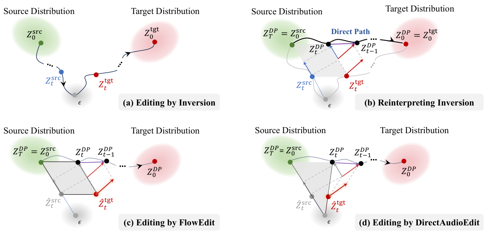

# DirectAudioEdit 精读：在干净编辑状态上比较反向位移

## 基本情况
*DirectAudioEdit: Inversion-Free Text-Guided Audio Editing via Diffusion Prediction Contrast*；按 arXiv 2606.07356v1（2026-06-05）阅读。公开仓库 NiuTrans/DirectAudioEdit，包含 AudioLDM2、Tango2 接入和多种 baseline。输入真实音频、源/目标文字；输出语义编辑音频。本文核心是离散扩散编辑，而非直接把 flow Euler 公式搬到 epsilon 预测模型。



图中把反演路径、直接路径和 clean-state 路径并列。理解时盯住目标模型实际吃到的带噪状态：是旧源状态的平移，还是当前干净编辑状态的重新加噪。

## ① 动机
真实音频没有天然生成噪声。反演会增加开销；在错误噪声尺度下查询目标网络又会把噪声伪影逐步累积。作者保留一个“干净尺度”的编辑状态，用共享噪声生成配对源/目标查询，然后只积累两个反向去噪位移的差。

## ② 架构与状态
预训练音频 VAE、文字编码器、UNet、vocoder 全部复用。源潜变量 `x_src` 固定；编辑状态 `y` 初始化为 `x_src`。每个时间步的噪声只负责构造查询，不替代 `y`。实际潜变量一般是二维时频张量；具体通道和长度随 AudioLDM2/Tango2 后端变化，不能认定通用 `[1,128,T]`。

## ③ 核心公式：共享噪声＋预测位移对比
```text
R_t(x;ε) = √ᾱ_t x + √(1−ᾱ_t) ε
q_t = R_t(x_src;ε),  p_t = R_t(y;ε)
q_prev = Φ_t(q_t, ε_src), p_prev = Φ_t(p_t, ε_tgt)
Δ_src = q_prev−q_t, Δ_tgt = p_prev−p_t
y_next = y + Δ_tgt−Δ_src
```

`ᾱ_t` 是累计信号系数；`Φ_t` 是选定 scheduler 的一次反向更新；`ε_src/ε_tgt` 是经过各自 CFG 的噪声预测。**对比的是反向位移，不只是原始 epsilon 差。** scheduler 中的系数也参与了编辑强度。共享同一个加噪 `ε` 才能消除不相关随机扰动；两个独立噪声通常会破坏这个配对。

动态 CFG 让编辑力度随进度调整；正文 §3.3 给出动机。当前源码还支持多个分段 guidance 值及 cosine/linear 插值，不能把当前接口当作论文唯一的实验参数。官方主函数用 `eta=0` 的 scheduler step，因此这里没有额外 DDPM 反向随机噪声需要耦合。入口中的 `args.eta=1` 属于其他流程设置，不能据此判断核心方法执行 DDPM 随机更新。

没有新的网络训练损失。论文理论讨论与完整 scheduler 位移应一起看；如果替换 scheduler，需要重新核对位移尺度，而不是沿用未经推导的 epsilon 差步长。

## ④ 数据和实验口径
音乐使用 MedleyMDPrompts；通用音频使用 AudioCaps 编辑集合，增加、删除、替换三类任务各 363 个，共 1089 个。实验片段以 10 秒为主。源/目标文字应尽量只改变一个属性，例如“钢琴独奏”改为“吉他独奏”；这里只作示意，不伪称公开样本原句。

论文报告相对 DDPM baseline 平均 FAD、KL 改善约 15.9%、15.8%，并在其配置中最高约 64.5% 加速。README 存在 51.5% 的加速概括；可能来自不同汇总口径，未取得逐配置一致证据，故不将两者合并。FAD 是集合分布指标，不能直接解释单条旋律有没有变。

## ⑤ 信息流
```text
音频→STFT/log-mel→VAE→固定 x_src；两段文字编码一次
y=x_src
每步：同一 ε→R_t(x_src),R_t(y)
   →冻结 UNet 源/目标预测＋CFG
   →同一 scheduler 分别反向一步→两种位移相减→更新 y
y→VAE decode→声码器→16 kHz 输出（该实现路径）
```

代码批处理按“目标、源”排列，然后为两者补齐文字 embedding 长度。共享噪声不意味着共享条件；源 CFG 和目标 CFG 也可以不同。

## ⑥ 数字例子与代码对应
示意 `√ᾱ=.6,√(1−ᾱ)=.8,x_src=2,y=3,ε=1`，得到 `q=2.0,p=2.6`。假设 scheduler 反向结果分别 `1.9,2.9`，则 `Δsrc=−.1,Δtgt=.3`，`y_next=3.4`。下一步重新构造 `R_t(3.4)`，并不把 `p_prev=2.9` 当作新的干净编辑状态。

`code/main_run.py::text2image_daedit_theory` 是当前算法核心：`scale_noise` 对应 `R_t`，`ldm_step_noise_2` 批量预测，两个 `.scheduler.step(...,eta=0)` 对应 `Φ_t`，最后 `zt_edit += zt_tar_delta−zt_src_delta`。名字里有 `image` 是继承旧接口，实际处理音频 latent。`ddm_edit`、`ddim_inversion` 是 baseline，不要误当作算法隐含反演阶段。

## 与相邻论文的关系和边界
与 FlowEdit 比较：当前目标重新加噪的位移乘了信号系数；与 EchoEdit+ 比较：都重视正确的目标查询分布，但一个比较扩散 scheduler 的离散位移，一个比较 rectified-flow 速度。不能只把公式中的噪声改名就宣称相同。

局限包括源描述依赖、生成器本身对音乐的能力限制、codec 重建误差，以及大范围编辑可能改变结构。共享噪声是构造机制，不是旋律或背景严格不变的证明。建议复现实验同时记录 codec-only、目标语义、音高轮廓、onset 与运行时间。


## 原文与核查说明

- [arXiv 原文](https://arxiv.org/abs/2606.07356v1)；本次核查日期：2026-10-12。
- [完整章节与公式定位](outline.md)、[原文正文](paper.tex)、[逐页文本](paper.txt)、[图表索引](figures/index.md)。
- [完整代码树](代码树.md)、[源码与原文对应](代码原文对应.md)。
- 文中的标量与小矩阵均为教学示意，非实际音频实验结果。论文报告、代码观察及研究建议分别陈述。未运行上游代码、未下载权重或训练集。
