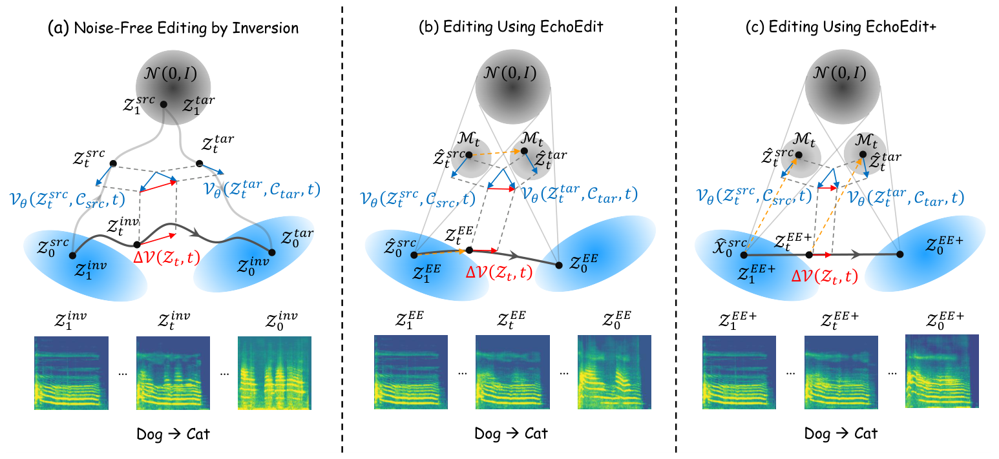

# EchoEdit / EchoEdit+ 精读：共享噪声之外还要检查查询均值

## 基本情况
*EchoEdit*；按 arXiv 2606.15149v2（2026-08-06，首版 2026-06-13）阅读。作者来自南开大学与北京灵汐科技等。本文把真实音频编辑放到预训练 flow 音频生成器中，并进一步用局部最优输运耦合稳定路径。截至 2026-10-12，本次未核验到可用于逐行对应的官方算法源码；论文中的实现细节不等于公开实现。



图中要比较的是每个时间点源与目标的带噪分布。EchoEdit+ 改变目标查询位置，使它符合当前干净编辑状态在该时间的前向核。

## ① 动机：轨迹漂移不是只因噪声太随机
FlowEdit 类型算法每步为源重新采噪，避免反演；但把完整编辑位移平移到高噪声状态上，目标位置可能偏离模型训练时见过的前向分布。即便把 Monte Carlo 平均次数提高，也不能自动消除这个均值偏差。EchoEdit+ 关注这层系统性问题。

## ② 模块和接口
基于冻结的 Stable Audio 3 medium、其音频 autoencoder、文字条件编码器和 flow 速度网络。音乐编辑实验使用 30 秒、44.1 kHz 音频配置。源潜变量 `x` 固定；当前编辑结果 `y` 持续更新；每步共享噪声 `ε`。模型输入是带噪潜变量和文字，模型输出同形速度，最后一次解码得到波形。

## ③ 从 EchoEdit 到 EchoEdit+
本文时间采用 `1 噪声→0 数据`。

```text
源查询 q_t = (1−t)x + t ε
EchoEdit：p_t = q_t + (y−x)
EchoEdit+：p_t = q_t + (1−t)(y−x) = (1−t)y+tε
共同更新：y_next = y + dt·[v_tgt(p_t,t)−v_src(q_t,t)]，dt<0
```

源前向分布与期望目标前向分布分别为：
```text
K_t(x)=N((1−t)x,t²I)
K_t(y)=N((1−t)y,t²I)
```
EchoEdit 的目标均值是 `(1−t)x+(y−x)`，比期望多出 `t(y−x)`。EchoEdit+ 将平移量缩为 `(1−t)(y−x)`，修正了这一偏差。

相同协方差的两高斯，在平方欧氏距离下以相同标准噪声耦合，可以达到局部 Wasserstein 代价：
```text
E||p_t−q_t||² = (1−t)²||y−x||²
```
这结论针对每一步已指定的高斯核。它没有证明真实音乐分布之间的全局最优输运，也没有证明潜空间欧氏距离等于听觉相似度。模型误差、CFG 及数值积分仍可导致漂移。无需训练新网络；OT 在这里是推理查询耦合，区别于 MelodyFlow 训练 batch 配对。

## ④ 数据与评价
音乐编辑集合由 SongDescriber 构造，报告 198 个编辑任务；音效编辑由 FSD50K 构造，报告 222 个任务。源文字与目标文字组成编辑对，任务数量不等于独立源音频数量。论文同时考察语义达成、源内容保留和音频质量。

实施细节包括 28 个 solver 步、从第 24 个编辑步设置进入、源 CFG 1.5、目标 CFG 4.5、每步一对噪声查询。这些数是作者实验配置；不能与不同硬件、不同片长、不同模型的加速比例直接排序。

## ⑤ 信息流与计算成本
```text
原音乐→autoencoder→x
源/目标文字→条件
y=x → 每步抽 ε
    →q=(1−t)x+tε
    →p=(1−t)y+tε（+ 的关键）
    →两条件速度→负时间步长更新 y
最后 y→autoencoder decoder→音乐
```
共享噪声可将两状态差确定为 `(1−t)(y−x)`；不是每步把编辑结果重新置回源音频。无反演降低了反演查询，却仍有源/目标预测，CFG 的成本要计入总 NFE。

## ⑥ 同一组数字看清分布偏差
令 `x=2,y=3,t=.8,ε=0`。源查询 `.4`；EchoEdit 目标查询 `1.4`；而干净状态 `3` 的前向均值应为 `.6`。偏差 `.8=t(y−x)`。EchoEdit+ 给 `.6`，修正偏差。

两查询之间的平方距离：旧构造 `(1.4−.4)²=1`，+ 构造 `(.6−.4)²=.04`。到 `t=.2` 时 + 的查询差变为 `.8`，说明语义位移在低噪声阶段自然放大。这只是构造的代数性质，不能根据这个玩具数值推断真实编辑一定更好。

由于没有核验到官方源码，本目录不提供伪装成官方实现的注释 Python 文件。复现时至少应核对：时间方向、源 latent 固定、同一步是否共享 ε、目标位移是否乘 `(1−t)`、CFG 定义、scheduler 是否非均匀。

## 实验意义与研究空间
论文在合成输运实验中报告音乐潜空间 MSE 从约 .64 降至 .12，支持其局部构造减少无关位移的主张；这是具体设置的结果。对于音乐结构，局部 latent OT 仍缺少旋律/节拍不变性目标。真正的后续创新需要建立音乐结构评价、分段或频带编辑，以及对不同 codec 的稳定性分析；仅照搬 `(1−t)` 不能宣称新算法。

对应原文请结合 [大纲](outline.md)、[正文](paper.tex) 与图2阅读；原文定位与源码状态见 [代码说明](代码原文对应.md)。


## 原文与核查说明

- [arXiv 原文](https://arxiv.org/abs/2606.15149v2)；本次核查日期：2026-10-12。
- [完整章节与公式定位](outline.md)、[原文正文](paper.tex)、[逐页文本](paper.txt)、[图表索引](figures/index.md)。
- [完整代码树](代码树.md)、[源码与原文对应](代码原文对应.md)。
- 文中的标量与小矩阵均为教学示意，非实际音频实验结果。论文报告、代码观察及研究建议分别陈述。未运行上游代码、未下载权重或训练集。
