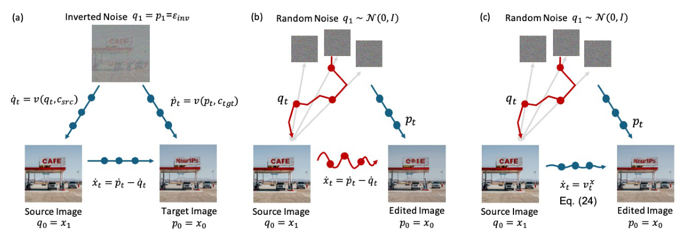

# FlowAlign 精读：用预测的干净端点校正无反演轨迹

## 基本情况
*FlowAlign: Trajectory-Regularized, Inversion-Free Flow-based Image Editing*，KAIST 团队，ICLR 2026；按 arXiv 2505.23145v4 阅读。公开 SD3 实现。它处理图像，不是现成音频算法；本文末端相似性与控制论推导应按 v4 版本理解。



## ① 动机
FlowEdit 的源参考每步重采噪，与目标积分轨迹并不共同满足两条精确条件 ODE。误差逐步积累，可能损害图像内容或反向编辑的恢复。FlowAlign 不恢复完整反演，而是给差分轨迹增加朝源内容回拉的校正。

## ② 状态与端点估计
仍设 `q=(1−t)x_src+tε`，`p=y+q−x_src`。请注意它保留完整编辑平移，并没有采用 EchoEdit+ 的 `(1−t)(y−x_src)`。

模型给出 `v_q,v_p` 后，在 rectified-flow 线性路径近似下估计干净端点：
```text
q̂_0 = q−t v_q
p̂_0 = p−t v_p
```
这些是速度模型推测的端点，不是真实目标样本。偏差大的模型也会给出偏差大的校正信号。

## ③ 最优控制解释与实际更新
正文 §3.3 建立控制问题：运行代价让控制速度接近条件速度差，末端代价要求编辑结果接近源：
```text
J = ∫ .5||u−(v_p−v_q)||²dt + η/2 ||y_0−x_src||²
```
在论文的推导与近似条件下获得带正则的控制。实际源码可直接读成：
```text
y_next = y + dt(v_p−v_q) + ζ(q̂_0−p̂_0)
```
最后一项把源/目标预测端点的偏移拉回，`ζ` 源码固定为 `.01`。它没有显式对完整采样过程反传；不是先求一遍全局最优控制再执行精确解。论文理论假设与实际神经速度场应区别。

这里的目标 guidance 是源条件锚定：
```text
v_p = v(p,c_src)+ω[v(p,c_tgt)−v(p,c_src)]
v_q = v(q,c_src)
```
与常规 unconditional CFG 不同。只增加端点项但沿用 FlowEdit 的空条件 CFG，并不是该公开实现的完全复现。

## ④ 数据与证据范围
主要图像评测使用 PIEBench（约 700 个编辑配置）及文本/图像保留相关指标，也展示视频与 3D 等扩展。反向编辑实验研究源→目标→源的恢复程度；这个实验支持可逆性改善，但不能证明离散求解器严格可逆，更不能证明音乐的节拍与旋律恒定。

代码 README 与论文硬件口径分别出现 RTX 3090 / RTX 4090，复现实验请记录实际 GPU、分辨率、NFE、精度、模型版本。不可直接从某个配置宣称所有机器都满足相同显存或时延。

## ⑤ 信息流
```text
图片→VAE→固定 zsrc；源/目标文字→条件
xt=zsrc
每步：eps→qt→pt
    →pt 的源/目标预测，qt 的源预测（3 种条件查询）
    →guidance→速度差＋端点校正→xt
xt→VAE decode→图片
```
不增加反传，不代表没有新增模型查询；对比 FlowEdit 必须按真实条件分支计算 NFE，而非只数 Python loop 次数。

## ⑥ 数字例子与代码差异
令 `q=.4,p=1.4,t=.8,v_q=1,v_p=2,dt=−.1,y=3`。则 `q̂_0=−.4,p̂_0=−.2`，校正量 `.01×(−.2)=−.002`，更新为 `2.898`。不加正则是 `2.9`。端点项方向由预测决定，不能先验说它每次都提高内容相似度。

`diffusion/editing/sd3_edit.py::SD3FlowAlign.sample` 中最后一条 `xt=...` 同时实现两项。该文件还包含 `SD3EulerFE`、`SD3Dual`、`SD3SDEdit` baseline，注意不要把 baseline 的 inversion 当作 FlowAlign 的内部阶段。静态核对：FlowAlign `sample` 接受 `n_start` 但未在循环中使用；FlowEdit baseline 会据此跳过早期时间步。保留原代码并标注这一接口差异，未擅自补行为。

## 音乐研究启发
可以在音频 flow 中测试端点校正能否减少旋律漂移，但 latent L2 往往也惩罚需要改变的音色。更有意义的候选是仅在不编辑的时间区域、频带或结构特征上校正。要证明创新，需要与 EchoEdit+、纯端点正则、源锚定 CFG 分别消融，而不是把三者同时引入再统一归因。


## 原文与核查说明

- [arXiv 原文](https://arxiv.org/abs/2505.23145v4)；本次核查日期：2026-10-12。
- [完整章节与公式定位](outline.md)、[原文正文](paper.tex)、[逐页文本](paper.txt)、[图表索引](figures/index.md)。
- [完整代码树](代码树.md)、[源码与原文对应](代码原文对应.md)。
- 文中的标量与小矩阵均为教学示意，非实际音频实验结果。论文报告、代码观察及研究建议分别陈述。未运行上游代码、未下载权重或训练集。
