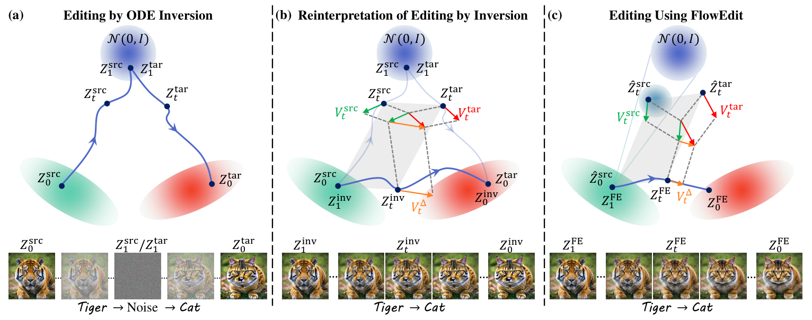

# FlowEdit 精读：去掉反演需要改变哪一步

## 基本情况
*FlowEdit: Inversion-Free Text-Based Editing Using Pre-Trained Flow Models*，Technion 团队，ICCV 2025；按 arXiv 2412.08629v2 阅读。输入图像和源/目标描述，输出编辑图像。公开 SD3、FLUX 推理实现，冻结预训练模型。它是图像方法，迁移音乐的适用性需要实验。



左边是先向噪声反演再向目标生成；中间把两条轨迹改写成一条源到目标的路径；右边进一步用源图像的解析加噪分布代替昂贵的反演轨迹。这两次变化不能合并成“换一个变量就自动无反演”。

## ① 动机
反演会增加模型查询，也会引入数值误差。直接对源图像加噪再生成又容易改变背景和布局。作者押注：将源和目标速度相减，使编辑状态只积累语义变化，而不必先走到共同噪声端点。

## ② 架构：模型不变，求解问题改变
系统仍是 VAE、文本编码器、flow Transformer 和解码器。新增的是编辑状态 `y` 及两种带噪查询位置。初始 `y=x_src`；`y` 不是普通噪声轨迹状态，最终才作为目标潜变量解码。

|量|含义|初始化/构造|
|---|---|---|
|`x_src`|固定源潜变量|VAE 编码一次|
|`y`|累积编辑结果|复制 `x_src`|
|`q_t`|源查询位置|每步解析加噪|
|`p_t`|目标查询位置|`y+q_t−x_src`|
|`v_src,v_tgt`|源/目标条件速度|同一冻结模型的不同查询|

## ③ 推导：精确重写不等于近似算法
采用 `t=1 噪声、t=0 数据`。若已有精确源反演轨迹 `z_src(t)` 和共享噪声起点的目标轨迹 `z_tgt(t)`，定义：

```text
y(t) = x_src + z_tgt(t) − z_src(t)
dy/dt = v_tgt(z_tgt,t) − v_src(z_src,t)
y(1)=x_src, y(0)=x_tgt
```

这条等式仍依赖源反演轨迹。FlowEdit 实际用：

```text
q_t = (1−t)x_src + t ε
p_t = y + q_t − x_src
Δv = average_ε [v_tgt(p_t,t) − v_src(q_t,t)]
y_next = y + (t_next−t) Δv
```

最后一步从 1 向 0 积分，`t_next−t<0`。随机平均降低估计方差，却不恢复“精确反演”的确定性轨迹；论文方法不是精确目标分布输运或全局 OT 的一般保证。正文 §4 是变量重写，§5 是替换和实际算法，附录 Full Algorithm 补全 `n_max,n_min,n_avg`。

不训练新参数，没有训练损失。与 DDS 同样利用条件预测差，但这里按照时间顺序求解编辑 ODE；DDS 则在采样时间和噪声下迭代优化潜变量，步长含义不同。

## ④ 数据与接口
论文基于图像 benchmark 和合成分布演示。SD3 使用二维图像 VAE 潜变量 `[B,C,H/scale,W/scale]`；FLUX 对潜变量打包为 token 序列，再还原。不能直接照搬音乐的 `[B,D,T]` 或宣称图像上的内容指标代表节奏保持。

一条输入包含源图像、源描述、目标描述、negative prompt、随机种子、solver 步数与 CFG。源文字不是装饰：源描述错误会改变被减去的速度，进而改变保留行为。

## ⑤ 信息流及超参数
```text
图片→VAE→x_src（固定）
两段文字→条件编码（缓存）
y=x_src → 每个 t: 抽 ε→q_t→p_t→两个条件速度→速度差→更新 y
最终 y→VAE decoder→编辑图片
```

`n_max` 控制开始编辑的位置；`n_avg` 是每个时间点平均多少个噪声；`n_min>0` 时末尾切换普通目标生成，而非一直执行差分 ODE。CFG 的条件/无条件分支会提高实际前向样本数；一次批量调用不等于只查询一个条件。

## ⑥ 数字例子与代码
示意 `x_src=2,y=3,t=0.8,ε=0`：`q=0.4,p=1.4`。若 `v_src=1,v_tgt=−1,dt=−0.1`，则 `y_next=3.2`。下一步 `t=.7` 再采 `ε=1`，`q=1.3,p=2.5`；同样速度差下 `y_next=3.4`。这显示每步参考噪声可变，而 `y` 保留前一步编辑。

最容易误写的是 `p`：它不是 `(1−t)y+tε`，两者差 `t(y−x_src)`。这正是 EchoEdit+ 的重要比较点。官方 `FlowEdit_utils.py` 中 `zt_src`、`zt_tar`、`V_delta_avg`、`zt_edit` 分别对应上式。FLUX 使用 scheduler 的 sigma；SD3 分支用 `t/1000`。读代码时应确认实际时间参数，不能只看变量名。

静态核对发现：SD3 的末尾普通采样分支将 `prev_sample` 转为 `noise_pred_tar.dtype`，但该名字未在该函数作用域定义；默认 `n_min=0` 不执行这一分支。注释保留上游代码并标记问题，未擅自修复，也未执行复现。

## 实验结论与局限
论文展示直接编辑在源保留与语义成功之间的较好折中，以及合成设置中较低的输运成本。其“低成本”是实验观察，不是对任意预训练速度场的全局最优证明。局部编辑、巨大语义变化和源文字不匹配仍可能失败。

复习问题：从两条精确 ODE 如何得到差分 ODE？实际算法在哪一步作近似？为什么 `p_t` 不能误换成当前结果重新加噪？`n_min` 为什么会改变算法末段？


## 原文与核查说明

- [arXiv 原文](https://arxiv.org/abs/2412.08629v2)；本次核查日期：2026-10-12。
- [完整章节与公式定位](outline.md)、[原文正文](paper.tex)、[逐页文本](paper.txt)、[图表索引](figures/index.md)。
- [完整代码树](代码树.md)、[源码与原文对应](代码原文对应.md)。
- 文中的标量与小矩阵均为教学示意，非实际音频实验结果。论文报告、代码观察及研究建议分别陈述。未运行上游代码、未下载权重或训练集。
