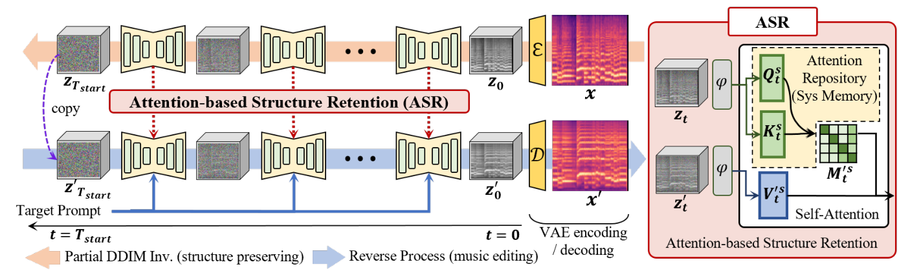

# Melodia 精读：把源音乐的注意力关系放进目标生成

## 基本情况
*Melodia*，Yi Yang 等，华南理工大学；AAAI 2026（Oral），按 arXiv 2511.08252v3 阅读。任务是文本引导的音乐音色/风格编辑，同时尽量保留旋律和节奏。公开 MelodiaEdit 数据与文档，但核验的官方提交未包含编辑推理实现。已有简短笔记保留，本文件为补充完整解读。



图左为源音乐 DDIM 反演并保存自注意力信息；图右为目标条件生成。关键是把源 Q、K 用在目标分支，目标的 V 继续提供新的内容，不能把它概括成“复制整个源注意力输出”。

## ① 动机
改乐器时希望保留同一旋律和节奏，但仅依赖文字差很难约束这些细节。作者先研究 AudioLDM2 不同注意力层中是否能读出音乐属性，再利用对时间结构有帮助的注意力关系进行编辑。

## ② 架构与 ASR
基于 AudioLDM2 的 mel-VAE、UNet、文字条件和 vocoder。UNet 有 16 个被分析的注意力层，方法选择部分层（报告的区间为 8–14）进行自注意力替换。其核心可写为：
```text
A_src = softmax(Q_src K_srcᵀ / √d)
O_edit = A_src V_target
```
`Q,K` 决定“哪些时频位置相互关联”；`V` 是被聚合的目标内容。沿用源关系而保持目标值向量，有机会保留音乐组织又允许音色变换。并非所有层都强行复制，更不是替换 cross-attention 文本条件。

## ③ 训练与推理要分开
属性 probing 用分类器观察特征所包含的信息；训练这些 probe 不等于训练音乐编辑模型。实际编辑器冻结 AudioLDM2，采用部分 DDIM 反演、缓存源 Q/K，再按目标文字去噪并实施 ASR。

不需要源 prompt，不等于不需要反演。源音乐本身提供注意力缓存；把 Melodia 列为 inversion-free baseline 会混淆算法类别。探针某个属性准确率低，也不能证明表示里绝对没有该属性，只能说明该探针在该任务上未有效读出。

## ④ MelodiaEdit 数据与指标
数据包含 2015 对编辑样本，其中 1090 合成对、925 真实音乐编辑对，关联 MusicDelta、ZoME 等来源。这里的“对”不能直接解释成 2015 段互不重复的原始录音。

|评价|量什么|不足|
|---|---|---|
|CLAP|目标文字与音频语义相似|未必敏感于音符和节拍|
|Chroma 相似|八度折叠后的音高类别|可能漏掉八度错误与复调变化|
|LPAPS|感知音频距离|也惩罚想要发生的音色变化|
|ASB|归一化后的语义/感知保留折中|依赖所评估集合的统计量|
|AMB|归一化后的语义/旋律保留折中|不宜跨论文直接比较分数|

ASB、AMB 采用归一化后组合（正文的调和聚合），包括 Z-score/min-max 环节。换评价集合可能改变归一化及最终排名，所以复现时要公布原始分量。音乐数据没有可严格对应的编辑后真实录音时，保留度不等于逐采样重建误差。

## ⑤ 信息流
```text
源波形→log-mel→VAE latent
    →部分 DDIM inversion→每层每步保存 Q_src,K_src
目标文字→条件编码
    →去噪：选中层用 softmax(Q_src K_srcᵀ/√d)×V_target
    →latent→mel→vocoder→编辑音乐
```
缓存占用随层、时间步、token 数增长；推理代价不只目标去噪。更强的注入通常有保留与语义变化之间的折中，论文用层分析指导选层，而不是证明这些层独立编码全部音乐结构。

## ⑥ 数字例子与源码状态
示意两时间位置的源注意力为 `A=[[.8,.2],[.1,.9]]`，目标值 `V=[10,20]ᵀ`。输出是 `[12,19]ᵀ`。如果复制源 `V=[1,2]ᵀ`，会得到 `[1.2,1.9]ᵀ`，目标内容也被拿掉了。这个例子说明保留的是关联权重，不是强制复用源声音。

官方仓库固定提交的完整树见 [代码树](代码树.md)。没有推理 `.py`，所以不提供冒充官方 ASR 的逐行注释。代码状态、对应原文章节和待核验项见 [对应说明](代码原文对应.md)。数据 README 与许可证保留，便于未来正式代码发布后补充。

## 实验与局限
在 MelodiaEdit 的具体比较中，Melodia 的 CLAP 约 .39、Chroma 约 .68，MusicMagus 约 .27、.73：前者语义更强，并非每个保留指标都最好。应看折中曲线和主观评价，不能只挑综合分数。

对你的研究最有用的是“音乐结构需要专门观察和评价”的证据，而不是将注意力注入等同于结构不变性。未来与无反演法结合时，要先解决没有源反演轨迹时 Q/K 从哪里取得、跨时间噪声是否匹配，以及结构注入是否重新引入两倍推理代价。


## 原文与核查说明

- [arXiv 原文](https://arxiv.org/abs/2511.08252v3)；本次核查日期：2026-10-12。
- [完整章节与公式定位](outline.md)、[原文正文](paper.tex)、[逐页文本](paper.txt)、[图表索引](figures/index.md)。
- [完整代码树](代码树.md)、[源码与原文对应](代码原文对应.md)。
- 文中的标量与小矩阵均为教学示意，非实际音频实验结果。论文报告、代码观察及研究建议分别陈述。未运行上游代码、未下载权重或训练集。
