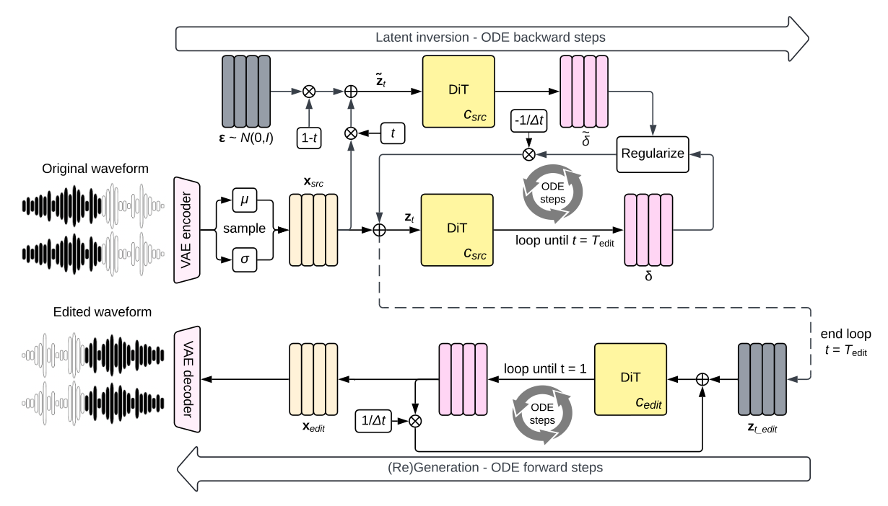

# MelodyFlow 精读：从连续音乐潜变量到反演编辑

## 基本情况与阅读地图
Meta；Gael Le Lan 等。正式标题 *High Fidelity Text-Guided Music Editing via Single-Stage Flow Matching*。本文按 arXiv 2407.03648v2（2024-10-16）阅读。任务是“真实音乐＋目标文字 → 保留部分内容的新音乐”。官方模型与推理代码已公开；训练数据和全部训练流水线不能据此视为完整公开。

路线：① 为什么用连续 codec → ② VAE、DiT 与文字条件 → ③ flow matching 训练 → ④ 音乐与潜变量样本 → ⑤ 生成/反演信息流 → ⑥ 数字例子与源码。公式、章节的精确原文位置见 [outline](outline.md)，源实现与固定提交见 [代码原文对应](代码原文对应.md)。



图的上半部分先把原音乐压成连续潜变量，再向噪声方向反演；下半部分换目标文字，沿生成方向得到新潜变量并解码。两个方向调用同一个速度网络，改变的是时间方向和条件。

## ① 动机：生成模型如何编辑已有音乐
如果直接用“吉他独奏”重新生成，原钢琴的旋律、节奏和具体演奏很容易消失。音频很长，直接在 48 kHz 波形上做 Transformer 又昂贵。作者把两个问题分开：codec 用低帧率连续表示压缩音乐；flow 网络学习在这个空间里从噪声生成音乐。真实音乐先反演，才能利用同一个生成器编辑。

必须区别三个概念：连续潜变量不等于波形；无离散码本不等于无损；single-stage 指潜变量生成过程，不表示整个系统没有 codec，也不表示编辑没有反演。该模型是后面研究无反演音乐编辑的基础模型候选。

## ② 架构与接口
medium 配置用 48 kHz 立体声 VAE，潜变量帧率 25 Hz、维度 128。30 秒波形有 `2×1,440,000` 个采样值，生成器处理约 `750×128` 个连续数。代码常用 `[B,128,750]`，论文叙述可写 `[B,750,128]`，注意维度排列。encoder 的原始输出还可能包含均值和尺度，不能直接把所有通道都解释成已采样潜变量。

|模块|输入 → 输出|作用与更新|
|---|---|---|
|波形 VAE codec|立体声波形 ↔ 连续潜变量|单独训练后冻结，降低序列长度|
|文字编码器 T5|文字 → 条件序列及 mask|提供语义条件；不是音符监督|
|DiT（约 400M / 1B 配置）|潜变量、时间、文字 → 同形速度|U 形跳连、交叉注意力；flow 训练更新|
|ODE solver|速度多次查询 → 最终潜变量|无可训练参数|

small 配置为 32 kHz 单声道、20 Hz、10 秒，不能把 medium 的形状套到所有权重。L 形注意力 mask 服务于长度泛化；mini-batch OT 给训练噪声与音乐重新配对以降低路径成本，并不等于全数据最优输运。

## ③ 训练：监督的是速度
本文时间为 `t=0 噪声，t=1 音乐`，与 FlowEdit 的常用时间方向相反。

```text
z_t = t·x + (1−t)·ε
u_t = x−ε
L_FM = E ||vθ(z_t,t,c) − (x−ε)||²
```

`x` 是标准化后的音乐潜变量；`ε` 是同形高斯噪声；`c` 是文字；`vθ` 输出每个潜变量元素的变化率。示意：`x=2, ε=−1, t=0.4`，则 `z_t=0.2`，正确速度是 `3`。若网络给 `2.5`，该元素平方误差是 `0.25`。训练不是预测下一个离散音乐 token。

先训练 codec，使用 KL、重建/多分辨率谱损失与对抗项，立体声还考虑声道和/差。论文配置为 200k 步、1 秒音频片段、AdamW 学习率 3e−4。flow 阶段冻结 codec；small/medium 分别训练 240k/120k 步，batch 576，8 张 H100 96 GB，约 3/6 天。采用 logit-normal 时间采样、20% 文字 dropout、bfloat16、EMA。详细配置属于论文实验配置，不能从公开推理接口反推训练完全可复现。

## ④ 数据与一条样本
论文描述约 20k 小时训练音频，来源包括约 10k 内部曲目、25k Shutterstock 曲目及 365k Pond5 曲目，均有文字描述。小时数与曲目数是不同单位。模型发布说明中另有约 16k 小时口径，当前资料不能证明二者是同一次训练，故保留版本差异。

|字段|medium 示意形状|语义|
|---|---|---|
|waveform|`[1,2,1440000]`|30 秒、48 kHz 双声道|
|caption|字符串|例如“轻柔钢琴演奏”；这里是说明性例子|
|sampled latent|`[1,128,750]`|codec 后验采样并标准化|
|noise / target velocity|同上|噪声及 `x−ε`|

codec 帧不是固定音符；25 Hz 不意味着可以逐帧精确控制乐谱。

## ⑤ 输入输出信息流
```text
生成：文字→T5（一次） + 高斯潜变量 [B,D,T]
    → vθ(z,t,c) → ODE 多步 → 反标准化 → codec decoder → 立体声波形
编辑：原波形→encoder→后验采样/标准化
    → 原条件下 1→t_edit 正则化反演
    → 目标条件下 t_edit→1 生成→decoder
```
反演越深，可编辑程度通常越强，原音乐保留也越难。正则化反演在每个 ODE 步里做多次固定点估计，并让当前速度的局部统计接近在真实加噪参考上预测的速度；这不是重新训练 DiT。末两次估计按索引加权，默认 4 次时权重对应 `2/5、3/5`。实际代码还在 KL 正则内部做梯度更新，因此“没有模型训练”不等于“推理完全没有梯度计算”。

## ⑥ 用数字走两步，并对照源码
示意潜变量 `x=2`，从 `t=1` 反演到 `0.8`，源速度给 `3`，Euler 得 `2+(−0.2)×3=1.4`。换吉他条件后从 `0.8` 到 `0.9`，目标速度给 `4`，得到 `1.8`；再到 `1`，若速度给 `2`，得到 `2.0`。这些标量只解释求解过程，不是实际钢琴到吉他的模型预测。

`models/melodyflow.py::edit` 明确连续调用两次 `_generate_tokens`，先 `source_flowstep=1`，再 `target_flowstep=1`；`models/flow.py::generate` 执行时间表、速度查询、正则化与更新；`utils/renoise.py` 负责局部 KL。详见注释版。代码 CFG 写成 `(1+a)v_cond−a v_uncond`，换到常见写法 `v_uncond+s(v_cond−v_uncond)` 时 `s=1+a`，比较实验配置时必须转换。公开代码还默认使用 sway 非均匀时间表，论文的均匀步长不能直接等同于当前默认参数。

## 实验、边界与研究启发
论文比较普通反演、ReNoise 与其 flow 正则反演，并用客观语义/保留度和主观评价衡量。评价重点是质量与源内容保留的折中，不是保证逐音符不变。codec 重建本身就是不可忽略的误差下界；后续无反演算法应首先报告“仅编码解码”的旋律和节奏指标，再报告编辑增量损害。

阅读检查：能否从 `z_t` 推出目标速度？能否解释为何反演用负步长？能否将代码 CFG 换成标准 CFG？能否说明 batch OT、反演 KL 与无反演 OT 耦合分别在什么阶段发生？


## 原文与核查说明

- [arXiv 原文](https://arxiv.org/abs/2407.03648v2)；本次核查日期：2026-10-12。
- [完整章节与公式定位](outline.md)、[原文正文](paper.tex)、[逐页文本](paper.txt)、[图表索引](figures/index.md)。
- [完整代码树](代码树.md)、[源码与原文对应](代码原文对应.md)。
- 文中的标量与小矩阵均为教学示意，非实际音频实验结果。论文报告、代码观察及研究建议分别陈述。未运行上游代码、未下载权重或训练集。
