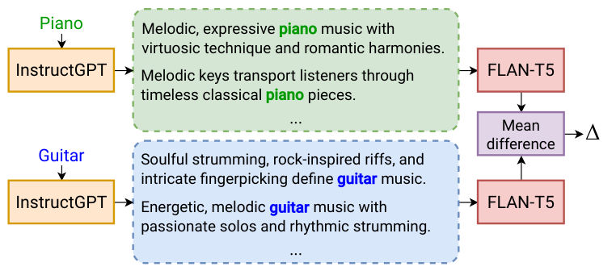

# MusicMagus 精读：语义方向与交叉注意力约束

## 基本情况
*MusicMagus: Zero-Shot Text-to-Music Editing via Diffusion Models*，QMUL、Sony 等团队；IJCAI 2024，按 arXiv 2402.06178v3 阅读。官方 MusicMagus 仓库公开编辑 pipeline、文本方向计算器和界面。输入音乐及源/目标属性，输出换音色或风格后的音乐。是重要零样本 baseline，但真实音乐路径需要 DDIM 反演。



## ① 动机
把“piano”直接改成“acoustic guitar”不仅改变语义，还改变 token 长度和交叉注意力布局。重新生成会改变旋律。作者用一组属性描述估计平滑的文本 embedding 方向，并约束编辑过程的交叉注意力贴近原始过程。

## ② AudioLDM2 条件链
音频经 16 kHz log-mel、VAE 得到时频 latent；UNet 预测噪声，vocoder 合成波形。条件含 T5 序列（特征维约 1024）和 CLAP→投影→GPT2/AudioMAE 语义序列（8×768）。不能把两个条件分支混为一个句向量。

用多条源/目标属性 caption 的平均嵌入差得到 `Δ`，在 T5 条件上加方向；另一语义分支从目标 prompt 重新编码。不是把 `Δ` 直接加到音频 latent。

## ③ 文本方向与注意力约束
```text
Δ = mean(E_T5(target captions))−mean(E_T5(source captions))
E_edit = {E_T5(source prompt)+Δ, E_GPT(target prompt)}
L_t = ||M_edit(t)−M_source(t)||²
z_t′ = z_t−a∇_z L_t
```
然后用修正后的 `z_t′` 再查询噪声并执行普通 denoising。模型权重冻结，但每步仍对 latent 优化并通过注意力反传。它与 SteerMusic 的 DDS latent 优化不同：这里梯度来自注意力重建损失，主流程仍是反演/去噪。

用 InstructGPT 生成描述集合以减小单句差异；caption 长度对齐帮助维持 attention shape。当前代码也会截断或补零方向以匹配 prompt 长度，属于实现容错，不等于语义信息毫无损失。

## ④ 数据和实验设置
论文主要使用 5 秒、16 kHz 配置、100 步 DDIM、注意力梯度步长约 .04，单张 A100。报告质量筛选后的 60 个生成音色编辑样例与 50 个风格样例，以及 26 位参与者主观评价。生成音频可复用初始噪声，与真实录音通过反演编辑是两种路径；生成集合上的成绩不能代替真实音乐结论。

真实音乐需要 caption；论文使用 MU-LLaMA 与语言模型处理文字，而公开仓库还带 LPMC captioning 代码。二者属于不同的可选工具链，不能声称仓库里每项都与论文完全一致。代码中的旧 OpenAI Completion 接口是版本依赖，阅读不等于当前 API 可直接运行。

## ⑤ 信息流
```text
属性词→生成 caption 集合→T5→源/目标平均差 Δ（可缓存）
真实音乐→caption→mel-VAE→DDIM 反演→起始 latent
参考生成→缓存各步 cross-attention
编辑：源 T5+Δ，目标 GPT 分支
    →attention loss→latent 梯度一步→重新预测噪声→scheduler
最终 latent→mel→vocoder→音乐
```
参考 attention 按时间步保存，目标编辑时取相同步的参考；源码使用全局 `CURRENT_TIMESTEP/CURRENT_LOSS` 管理缓存，不应无保护地并发共享同一 pipeline。

## ⑥ 数字例子与源码
示意源 caption 平均向量 `[1,2]`，目标 `[3,1]`，则 `Δ=[2,−1]`；原 prompt 向量 `[.5,2.5]` 加后变 `[2.5,1.5]`。这只作用于条件。

再设某步 latent 为 `2`，attention loss 对它的梯度 `.3`、步长 `.04`，修正为 `1.988`；用 `1.988` 重算噪声，再去噪一步。第二个时间步还会重新计算 attention loss，因此不是只在开始修正一次。

`audioldm2/embedding_calculator.py` 生成与平均 captions；`p2p_pipeline.py::construct_direction` 求差；`Pix2PixZeroAttnProcessor` 存取注意力；pipeline 的第二 denoising loop 用 SGD 更新 `x_in`；`invert` 负责真实音频反演。注释版和原文位置见 [代码原文对应](代码原文对应.md)。代码默认注意力步长与论文 .04 不应自动认定相同，应以调用参数记录为准。

## 局限与地位
相比后续无反演方法，MusicMagus 增加反演、参考注意力缓存及梯度计算成本；但为音乐编辑建立了语义变化/结构保留分离的基线。注意力相似不是音乐理论保证，复杂复调、长音乐、巨大风格变化仍可能改变内容。公平比较应统一 backbone、片长、codec 和评价，或清楚说明无法统一的因素。


## 原文与核查说明

- [arXiv 原文](https://arxiv.org/abs/2402.06178v3)；本次核查日期：2026-10-12。
- [完整章节与公式定位](outline.md)、[原文正文](paper.tex)、[逐页文本](paper.txt)、[图表索引](figures/index.md)。
- [完整代码树](代码树.md)、[源码与原文对应](代码原文对应.md)。
- 文中的标量与小矩阵均为教学示意，非实际音频实验结果。论文报告、代码观察及研究建议分别陈述。未运行上游代码、未下载权重或训练集。
