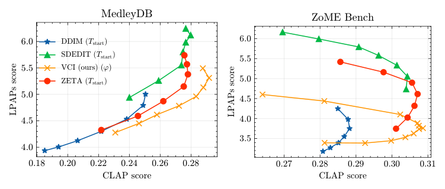

# Virtual Consistency 精读：构造一致性参考噪声来编辑音频

## 基本情况
按 arXiv 2509.17219v1（2025-09-21）阅读，Matthieu Cervera、Francesco Paissan、Mirco Ravanelli、Can Subakan。公开 VCI_Editing，实现 AudioLDM/AudioLDM2 下的无反演、少步编辑。Virtual 表示利用现有扩散预测及解析参考构造一致性更新，不是训练一个全新的 consistency 网络。



## ① 动机
普通反演需要额外去噪模型调用；少步生成又容易损失原音频。作者从 DDIM/一致性采样关系出发，构造能指向源干净样本的一致性噪声，再掺入源/目标预测差，兼顾重建与编辑。

## ② 状态与模型
固定源干净 latent `x_0`，维护源/目标带噪状态 `x_source_t,x_target_t`。同一个冻结 denoiser 在源/目标条件下预测 epsilon。scheduler 除普通 `ᾱ_t` 外还处理边界条件 `c_skip,c_out` 与下一步共享随机噪声。

## ③ 公式及假设
从 DDIM 类更新中选择 `σ²=1−ᾱ_prev`，残余方向项系数变为零，使每一步可以解释为干净估计与新噪声的混合。对源状态构造：
```text
ε_cons = (x_source_t−√ᾱ_t x_0) / √(1−ᾱ_t)
ε_edit = φ/√2·(ε_tgt−ε_src) + √(1−φ²)·ε_cons
x̂_target_0 = (x_target_t−√(1−ᾱ_t)ε_edit)/√ᾱ_t
```
`φ∈[0,1]` 控制保留/编辑；`φ=0` 退化到一致性参考项，`φ=1` 仅保留差分项。系数中的 `√2` 与噪声方差假设有关，不能在两个高度相关预测间无条件保证单位方差。

**论文与代码差异：**当前实现对组合 `v` 减均值，再除标准差；`phi=None` 的分支除的是 `mean(sqrt(v²))`，即平均绝对值。正文简式不能体现这些归一化。随后还有 `c_out*x̂_0+c_skip*x_t`，因此不能仅凭理想公式声称 `φ=0` 时所有边界、codec 与有限步长都精确保持原音频。

## ④ 数据和实验
ZoME 为 943 个 10 秒片段配置；MedleyMD 实验包含 13 个较长片段上的 259 项编辑，片长约 17 秒至 2 分钟。不同表格的样本单位和片长不同，应独立阅读。

报告 8 步 ZoME、20 步 MedleyMD 设置。ZoME 表中 VCI 约 1.615 秒、Control 约 1.631 秒，DDIM 约 16.164 秒、ZETA 约 23.758 秒；MedleyMD 约 12.483 秒，对比 DDIM 43.481 秒。实验使用 H100 的 3/8、40 GB 分区。这些只是该论文条件，不能与不同 backbone 的 EchoEdit 或 DirectAudioEdit 做绝对速度排名。

## ⑤ 信息流
```text
源音频→mel-VAE→x_0
构造初始源/目标带噪状态
每个 t：源状态+x_0→ε_cons
      源/目标状态与文字→ε_src,ε_tgt
      组合、去均值与归一化→ε_edit
      干净目标估计→边界系数组合
      同一下一步噪声→两条新状态
最终目标→VAE/vocoder→音频
```
源路径每步重新锚定 `x_0`，目标路径积累变化。下一步噪声在两分支共享，与“每一步用独立的源/目标噪声”不同。

## ⑥ 数字例子
示意 `√ᾱ=.6,√(1−ᾱ)=.8,x_0=2,x_source_t=2`，则 `ε_cons=1`。若 `ε_tgt−ε_src=.4,φ=.6`，理想组合为 `.6/√2×.4+.8×1≈.970`。若目标状态为 `2.6`，则干净估计 `(2.6−.8×.970)/.6≈3.040`。这是正文未归一化简式；实际代码需要一整个张量才能计算均值与标准差，单标量不能直接模拟归一化，否则标准差可能无定义。

源码 `ldm/models/diffusion/scheduling_lcs.py::edit_step_ldm` 是完整对应，尤其要看 `epsilon_cons`、CFG、`epsilon_edit`、boundary scalings 与共享 `noise`。`InferenceLCM.py` 和 `edit_main_run.py` 负责调用。注释版保留了全部上游语句，仅加中文解释，未跑模型。

## 局限
一致性参考提供重建锚点，但不是音乐结构专用约束；少步结果可能受 normalization、噪声 schedule 与模型条件能力影响。用于研究时应分别消融 `φ`、归一化、边界项和步数，不能把它们全称为“一致性”的一个不可分模块。


## 原文与核查说明

- [arXiv 原文](https://arxiv.org/abs/2509.17219v1)；本次核查日期：2026-10-12。
- [完整章节与公式定位](outline.md)、[原文正文](paper.tex)、[逐页文本](paper.txt)、[图表索引](figures/index.md)。
- [完整代码树](代码树.md)、[源码与原文对应](代码原文对应.md)。
- 文中的标量与小矩阵均为教学示意，非实际音频实验结果。论文报告、代码观察及研究建议分别陈述。未运行上游代码、未下载权重或训练集。
