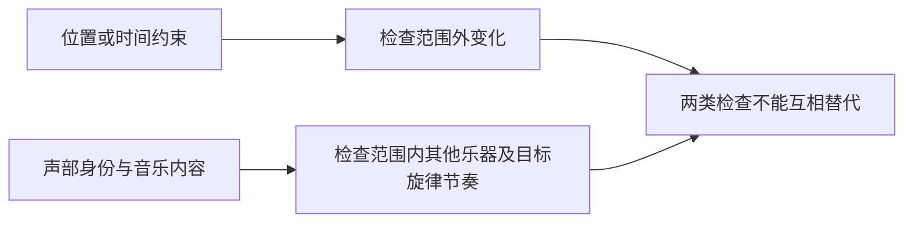

# Mode C：无需新增训练的音乐编辑——证据交叉矩阵

> 日期：2026-10-27  
> 包类型：MODE_C_PACKAGE；版本：research-pipeline-contract v1.0 / Mode C+ v1.0  
> 矩阵/包 ID：MODEC-20261027-MUSIC-PRESERVATION-v1；证据状态：partial  
> 上游：[六篇ANALYSIS_PACKAGE](https://github.com/wang1673/-/blob/64f8c5728df46c66e31d57434b754b233062de1f/research/music-editing/2026-10-27/outputs/ANALYSIS_PACKAGES.json)  
> 上游commit：`64f8c5728df46c66e31d57434b754b233062de1f`；文件blob：`3fbb049fde81879fc7bc56436ff391b44016d8ce`  
> [机器可读交接包](MODE_C_PACKAGE.json) · [证据与独立性审计](evidence-audit.md)

## 1. 研究边界与当前判断

当前优先连接是 **C01：时间/时频局部性与复音声部选择性是否脱钩**。它有可定位的局部外溢示例与混合声音建模依据，但“同时间非目标乐器是否被破坏”尚未得到本批文献的联合分轨证据。

**C02 是测量前置检查**：不能把复制原音、目标未改和音色改对且结构保住混为一谈。**C03 是比较前置检查**：先固定信息条件、优化对象和完整成本，再解释收益。

这些是研究联系与拟议诊断，不是已经证明的新机制、新方法或完成的实验。

本轮目标：

1. 区分时间/时频局部性与复音声部/目标旋律节奏保持，并审计支持证据。
2. 比较A/B两类冻结权重路线，分开算法、信息条件、成本与评测。
3. 筛选最多3个有定位依据、可做低成本诊断的连接点，暂不设计完整新方法。

范围：仅以用户指定六个ANALYSIS_PACKAGE为主体；针对候选联系重读对应原论文HTML/固定GitHub代码。未扩展为全部音乐编辑文献检索。

不包含：不将EdiTTS语音结果当音乐结果；不将一般事件编辑当多声部实证；不混用同名指标数值、不同checkpoint/硬件；不生成IDEA_PACKAGE或完整方案。

新颖性范围：未做扩展新颖性检索；仅六篇及其针对性原文核对。评分不可被解读为尚无同类研究。

本轮没有执行训练、生成、指标计算、分轨评估、硬件计时或听测。DE只代表核对到文档/公式/代码，不代表独立复现实测；机制归因、跨域迁移和未执行诊断保留AI/SC/UN标签。

## 2. 先明确“保持”的对象

以下区分来自本次问题定义和证据整合（AI），不是六篇已验证的统一指标体系：

| 维度 | 要问的问题 | 不能用来替代它的证据 |
|---|---|---|
| 目标编辑完成度 | 原乐器/音色是否按要求改变，旧乐器是否仍在？ | 仅CLAP升高或加入目标纹理 |
| 时间范围外保持 | 指定编辑区间之外的事件是否误变？ | 全曲平均相似度 |
| 范围内非目标声部保持 | 与目标同时发声的其他乐器是否误变？ | mask外保持或时间mask存在 |
| 目标音乐内容保持 | 换音色后，目标音符、旋律、拍位与节奏是否仍符合要求？ | 原始波形逐点相同、单一谱相似度 |
| 长程/声像保持 | 节拍、段落与立体声空间是否符合任务要求？ | 10秒或下混mono的分数 |

合法音色替换应改变部分声学特征；“保持所有波形都不变”与“成功替换音色”不是合理的同一要求。评价前需说明允许变化的力度、包络、演奏方式与空间属性，不能替用户隐含固定。

## 3. 两类冻结权重路线

| 类别 | 纳入路径 | 计算与信息条件 | 音乐证据边界 |
|---|---|---|---|
| A：无逐样本梯度优化 | DirectAudioEdit核心路径、ZETA | DAE双分支/CFG前向；ZETA反演与噪声序列 | 有音乐结果，但非声部级硬保持保证 |
| A的辅助对象 | ZEUS、EdiTTS | ZEUS额外PC迭代；EdiTTS双轨采样 | ZEUS不是可预先指定语义的文本编辑；EdiTTS仅语音机制参考 |
| B：允许梯度优化 | AudioMorphix相关路径 | latent SGD与能量引导；参考音频/mask可能增加信息 | 主要事件基准，mask条件音乐定量缺口 |
| B：允许梯度优化 | AudioEditor完整路径 | null/条件embedding优化，可能经过网络求输入梯度 | AudioCaps事件，非音乐专项 |
| B：允许梯度优化 | MelodyFlow正则反演 | prediction KL修正、反演重复与参照前向 | 音乐直接相关，但公开版/论文版及指标要分开 |

依据：E07–E10、E13–E16。分类针对实际配置，不针对模型名永久定类。关闭正则或优化开关后得到的消融不能继续冒充完整方法；也不能因score输出或普通采样有“梯度”概念，就将其误归为逐样本拟合。MF代码的`cfg_coef=0`也不能仅凭数字被解释为条件被去掉，需核对具体CFG公式和source文本。

## 4. 来源—证据地图

| S ID | 固定来源/上游包 | 对象与可用证据 | 本轮核对与缺口 |
|---|---|---|---|
| S-DAE | [DirectAudioEdit: Inversion-Free Text-Guided Audio Editing via Diffusion Prediction Contrast](https://arxiv.org/pdf/2606.07356v1)；arXiv:2606.07356v1，2026-06-05；预印本；`ANALYSIS-20261027-DAE-v1` | 计算实验；AudioLDM2 与 Tango2，同骨干内比较 SDEdit、DDIM inversion、DDPM inversion；音乐用 MedleyMDPrompts 的前 10 秒，事件任务为 3×363=1089 对。 | 本轮重读上游固定commit的相关核心代码；[上游笔记](https://github.com/wang1673/-/blob/64f8c5728df46c66e31d57434b754b233062de1f/research/music-editing/2026-10-27/outputs/notes/directaudioedit.md) |
| S-AMX | [AudioMorphix: Training-free audio editing with diffusion probabilistic models](https://arxiv.org/pdf/2505.16076v1)；arXiv:2505.16076v1，2025-05-21；本次采用该预印本，不混用匿名投稿版；`ANALYSIS-20261027-AMX-v1` | AudioSet-E 合成声音编辑基准：addition 1442、removal 1426、replacement 1870；比较DDIM、DDPM和AUDIT；AudioLDM/Tango 两种骨干。移位、拉伸、音高任务主要定性。 | 关键代码核对继承上游包；本轮HF固定commit链接未成功重新访问，方法分类另用原文算法核对；[上游笔记](https://github.com/wang1673/-/blob/64f8c5728df46c66e31d57434b754b233062de1f/research/music-editing/2026-10-27/outputs/notes/audiomorphix.md) |
| S-AED | [AudioEditor: A Training-Free Diffusion-Based Audio Editing Framework](https://arxiv.org/pdf/2409.12466v2)；arXiv:2409.12466v2，2024-09-29；另有ICASSP2025发表记录，本次页码以v2为准；`ANALYSIS-20261027-AED-v1` | 一般声音计算实验；从AudioCaps test手工选择适合编辑的300段，分addition/deletion/replacement；主要比较SDEdit、原音频和目标文本直接重生成。不是专门音乐编辑基准。 | 本轮重读上游固定commit的相关核心代码；[上游笔记](https://github.com/wang1673/-/blob/64f8c5728df46c66e31d57434b754b233062de1f/research/music-editing/2026-10-27/outputs/notes/audioeditor.md) |
| S-MF | [High Fidelity Text-Guided Music Editing via Single-Stage Flow Matching](https://arxiv.org/pdf/2407.03648v2)；arXiv:2407.03648v2，2024-10-16；PDF自述Preprint/Under review；本次不将其视为正式会议最终版；`ANALYSIS-20261027-MF-v1` | 400M small/1B medium骨干；medium为48kHz立体声、25Hz codec、30秒。论文训练数据合计20k小时；客观编辑用8377首in-domain heldout tracks，主观编辑181个较高保真样本，LLM辅助genre变化提示人工复核。 | 关键代码核对继承上游包；本轮HF固定commit链接未成功重新访问，方法分类另用原文算法核对；[上游笔记](https://github.com/wang1673/-/blob/64f8c5728df46c66e31d57434b754b233062de1f/research/music-editing/2026-10-27/outputs/notes/melodyflow.md) |
| S-ZETA | [Zero-Shot Unsupervised and Text-Based Audio Editing Using DDPM Inversion](https://raw.githubusercontent.com/mlresearch/v235/main/assets/manor24a/manor24a.pdf)；ICML2024/PMLR235正式PDF，内部页1–27（卷页34603–34629）；LaTeX辅助源为arXiv:2402.10009v4；`ANALYSIS-20261027-ZETA-v1` | AudioLDM2（包括music与general检查点）；ZETA对照MusicGen-melody、DDIM、SDEdit；ZEUS对照源文本SDEdit。MusicDelta34首、107源提示、696目标提示，定量ZETA子采样324信号–文本对；有源和空源提示等设置。 | 关键代码核对继承上游包；本轮HF固定commit链接未成功重新访问，方法分类另用原文算法核对；[上游笔记](https://github.com/wang1673/-/blob/64f8c5728df46c66e31d57434b754b233062de1f/research/music-editing/2026-10-27/outputs/notes/zeta.md) |
| S-ETTS | [EdiTTS: Score-based Editing for Controllable Text-to-Speech](https://arxiv.org/pdf/2110.02584v3)；arXiv:2110.02584v3，2022-07-09；INTERSPEECH2022，会议页421–425；本次PDF页1–5；`ANALYSIS-20261027-ETTS-v1` | 单说话人LJ Speech；预训练Grad-TTS+HiFi-GAN；音高测试15句话、18名AMT参与者；内容替换80句，每句随机词换同义词，人工核验文本，Google STT测WER/CER。全部是语音，不是音乐实验。 | 本轮重读上游固定commit的相关核心代码；[上游笔记](https://github.com/wang1673/-/blob/64f8c5728df46c66e31d57434b754b233062de1f/research/music-editing/2026-10-27/outputs/notes/editts.md) |

**独立性**：DAE和ZETA共享MedleyMDPrompts/MusicDelta来源，不能当作独立歌曲集重复；一个曲目的多个提示或seed也不是多个独立曲目。MF、AMX、AED、EdiTTS提供不同任务/测量证据，不能简单票数合并成六篇一致验证。

## 5. 问题 P

| ID | 具体问题 | 对象/边界 | 标签与强度 | E IDs |
|---|---|---|---|---|
| P01 | 局部时间编辑如何避免改变编辑区间外的音乐事件？ | 指定时间区间；现有直接例子来自ZEUS鼓声编辑，向文本乐器编辑迁移仍未知。 | DE；中：有定位的实例，不是大样本普遍率 | E01 |
| P02 | 替换目标乐器音色时，如何保留其旋律/节奏及同时发声的非目标声部？ | 复音混合；目标音色允许变化，目标音符/时序和非目标声部通常不希望变化。 | AI；低至中：问题明确但没有联合声部级验证 | E02、E03、E04、E06 |
| P03 | 评价能否区分编辑未完成、允许的音色改变和不允许的旋律/节奏/声部改变？ | 必须同时评估目标修改成功与多种保持要求；整体相似不能单独当成功标准。 | AI；中：有指标和听测权衡，特定目标有效性仍需诊断 | E04、E05、E06、E11、E15、E18 |
| P04 | 允许逐输入梯度优化的收益，在同信息条件和可比计算预算下是否仍成立？ | 尽量同骨干、codec、输入、提示、随机种子；参考音频/mask属于额外信息，不仅是额外计算。 | AI；中：优化对象和成本结构可定位；统一收益曲线缺失 | E08、E09、E10、E11、E12、E13、E14 |
| P05 | 现有短片段/事件/语音/mono评价的结论，在长音乐和立体声局部编辑中适用到哪里？ | 时长、领域、声道、重叠密度需分别界定；不能一并假定可迁移。 | AI；中：已有范围限制明确，迁移结果未知 | E03、E15、E16、E19 |
| P06 | 不同默认参数、公开checkpoint与论文版本是否被误当成同一方法配置？ | 复现或消融前应分别固定代码、权重、scheduler、CFG、token/文本、codec与采样定义。 | DE；高：配置差异可定位；性能影响未知 | E17 |

## 6. 现象 F

| ID | 来源支持到什么 | 对象/边界 | 标签与强度 | E IDs |
|---|---|---|---|---|
| F01 | 局部PC编辑会影响mask外鼓声；论文示例中每步软回拉减轻该影响。 | ZETA论文的ZEUS例子，δ=.025；非所有任务的实证结论。 | DE；中：单实例+公式 | E01 |
| F02 | 音乐编辑听测中，质量/文本相关性较高的模型并不同时具有最高源一致性。 | MF Table1跨骨干比较，181样本；CON2.61对2.72，不能归因为算法单因素。 | DE；中：报告均值，跨模型混杂 | E04 |
| F03 | 同一方法的Tstart/CFG或反演正则强度变化，会改变文本对齐与源相似的报告曲线。 | ZETA和MF各自的内部设置，曲线与指标定义分开保留。 | DE；中：有曲线；未读原始逐运行数据 | E05 |
| F04 | 免显式反演的共享噪声直接更新，在DAE音乐基准上有较好的FAD/KL/SSIM报告均值。 | 两骨干前10秒、5 seeds；AudioLDM2音乐FAD对DDPM未显著；不是声部级保持证据。 | DE；中：多seed代理指标 | E06、E07、E19 |
| F05 | 三种不更新骨干权重的编辑路径仍分别优化embedding、latent或速度预测。 | AED、AMX-removal、MF regularized版本；优化对象/反传范围不同。 | DE；高：代码或原文算法定义 | E08、E09、E10 |
| F06 | AudioEditor消融中，Null优化和EOT处理对CLAP与FAD的变化方向不同。 | AudioCaps事件，非音乐；无差异CI；没有等成本消融。 | DE；中：单表格代理量 | E11 |
| F07 | 反演、CFG分支、PC迭代及正则参照会增加不同类型计算；“编辑步数”不是统一预算。 | DAE/ZETA/MF各论文计数与硬件环境；不跨论文比较绝对速度。 | DE；高于成本结构；性能收益为未知 | E07、E12、E13、E14 |
| F08 | 六篇证据覆盖不同领域、时长、声道和指标，且DAE与ZETA复用同一音乐基准来源。 | MF有音乐/立体声骨干，自动评价下混；AMX/AED主要事件，EdiTTS语音。 | DE；高于研究范围事实；跨域有效性未知 | E03、E15、E16、E19 |
| F09 | 部分公开实现的默认参数或模型版本，与论文实验定义不一致。 | DAE CFG、MF发布版数据处理、AED指数符号；不同问题分别记录。 | DE；高于差异存在；影响未知 | E17 |
| F10 | ZETA作者指出LPAPS对小的全局时序偏移与短旋律变化可能给出不符合音乐意义的变化量。 | §4.4讨论ZEUS评价；尚无本轮受控标定，不称为已独立验证规律。 | SC；低至中：作者解释，需诊断 | E18 |

F10是作者讨论，保留SC；F08是研究范围事实，不是对泛化失败的观察。上游P/F没有原样提升为已验证机制；ID映射保存在JSON各条目的origin_candidates。

## 7. 机制 M、条件与替代解释

### M01：P01 × F01

**链条**：局部更新→模型的时空交互可能影响其他位置→mask外回拉使当前步相对原轨迹的差值乘(1−δ)→所示例外溢减弱。

**状态**：部分支持：操作与示例支持，组件归因和跨设置未知。证据：E01。

| 链段 | 标签 | 证据或说明 |
|---|---|---|
| 网络交互造成外溢 | SC | E01 |
| 回拉减少当前步mask外差值 | AI | 由公式直接推导，后续采样/解码仍可能传播 |
| 示例结果外溢缓解 | DE | E01 |

成立条件：相同原轨迹、时间步对齐、mask含义一致；δ=.025是原设定，不是最优证明。

替代解释/反例：prompt本身要求全局变化；VAE/vocoder或边界接缝而非注意力主导；变化被抑制也可能是目标编辑变弱。

### M02：P02 × F01、F08

**链条**：多个乐器的能量/谐波共享时频与latent支持→位置mask不是声源身份→mask外保留不约束mask内非目标乐器→声部选择性仍需单独核验。

**状态**：待检验：合理推断，未被六篇联合声部级数据确认。证据：E02、E03、E01。

| 链段 | 标签 | 证据或说明 |
|---|---|---|
| 音频透明重叠与latent空间一致性前提 | SC | E02 |
| 位置保持不足以推出声部保持 | AI | 没有可定位直接测量 |
| 真实音乐重叠程度决定误改量 | UN | 没有可定位直接测量 |

成立条件：复音且目标与非目标同时发声；有可靠声部参照才可测归因。

替代解释/反例：模型可能已学到有效声源解耦；错误来自参考音频不匹配/文本歧义；分离器估计伪影可伪装成声部破坏。

### M03：P02、P03 × F02、F04、F06、F10

**链条**：目标音色改变会改变谱/感知特征，而复制输入通常提高源相似→整体距离同时混合允许与不允许的变化→高相似不必然等于成功编辑，低相似不必然等于旋律破坏。

**状态**：部分支持：指标和排名事实支持问题；具体音乐测量机制待标定。证据：E04、E06、E11、E15、E18。

| 链段 | 标签 | 证据或说明 |
|---|---|---|
| 对齐/一致性报告排名不同 | DE | E04、E11 |
| 允许音色变化与错误结构变化被同一距离混合 | AI | 没有可定位直接测量 |
| 具体指标对音乐要素的灵敏度 | UN | 没有可定位直接测量 |

成立条件：任务先定义允许改变的音色/力度/演奏属性；不可要求合法音色替换后的全部波形逐点不变；需控制编解码重建误差。

替代解释/反例：高一致性确实保留了有用结构；低距离源于目标编辑没发生；特征模型/时间对齐偏差主导。

### M04：P01、P02、P03 × F03、F04

**链条**：调整CFG/Tstart或正则→改变修改强度与轨迹约束→目标服从和源相似发生不同变化→局部性评估必须排除“编辑更弱”这一替代解释。

**状态**：部分支持：代理曲线可定位，声部级效应未知。证据：E05、E06、E07。

| 链段 | 标签 | 证据或说明 |
|---|---|---|
| 控制量改变指标曲线 | DE | E05 |
| 更弱编辑可能产生更高保持分 | AI | 没有可定位直接测量 |
| 调度单独决定非目标声部稳定性 | UN | 没有可定位直接测量 |

成立条件：同骨干/输入/seed/提示；先固定编辑是否成功，再解释保持差异。

替代解释/反例：调度仅改善数值稳定性；codec本底或CFG文本能力限制；source prompt信息变化。

### M05：P04 × F05、F06、F07

**链条**：不同优化对象→不同前向/反传/缓存成本与条件信息→相同步数不等于相同预算→不能仅按training-free或步数归因质量收益。

**状态**：成本结构已支持；性能优势是否保留待检验。证据：E08、E09、E10、E11、E12、E13、E14。

| 链段 | 标签 | 证据或说明 |
|---|---|---|
| 路径及计数差异 | DE | E08、E09、E10、E12、E13、E14 |
| 统一预算会改变性能排名 | UN | 没有可定位直接测量 |

成立条件：wall-time包含编码、反演、优化、解码与必要预处理；记录CFG有效batch与网络反传范围；同计算与同条件信息是两个维度。

替代解释/反例：优化确有额外机制收益；额外参考音频提供更多目标信息；显卡吞吐/缓存并行掩盖逻辑操作差异。

### M06：P03、P05 × F08、F10

**链条**：领域、时长、声道与特征空间改变→评价所能观测的结构不同→事件/语音或mono分数不能独自支持真实多声部/长曲/立体声结论。

**状态**：外推限制有直接依据；外部有效性未知。证据：E03、E15、E16、E19。

| 链段 | 标签 | 证据或说明 |
|---|---|---|
| 范围和指标定义不同 | DE | E03、E15、E16、E19 |
| 迁移后的误差大小 | UN | 没有可定位直接测量 |

成立条件：先在原测试范围内保留有效结论；不把尚无验证写成方法无效；外部曲目与提示共享要单独标记。

替代解释/反例：短片段结果可在相似域推广；长曲问题可能是模型窗口限制而非编辑机制；声像变化可能不是该任务要求保持的属性。

### M07：P04、P06 × F09

**链条**：默认CFG/权重/时间调度/公式版本不一致→实际运行对象改变→差异可能伪装为方法或优化效果。

**状态**：差异存在已支持，影响需要诊断。证据：E17。

| 链段 | 标签 | 证据或说明 |
|---|---|---|
| 版本/默认差异 | DE | E17 |
| 引起具体性能差异 | UN | 没有可定位直接测量 |

成立条件：分别记录paper配置和released配置；不擅自修正文中符号。

替代解释/反例：差异不影响实质结果；新版修正了旧问题；不同任务原就采用不同设置。

## 8. P × F交叉矩阵

每格都给出**状态、理由、M/E定位**。✅仅支持该单元限定的关系；◐为合理但未闭合；△需低成本诊断；—为当前材料未形成联系，不是否定方向。

矩阵分成两块显示同一10×6矩阵，完整60格见JSON。

### P01 / P02 / P03

| F | P01 局部时间编辑如何避免改变编辑区间外的音乐事件？ | P02 替换目标乐器音色时，如何保留其旋律/节奏及同时发声的非目标声部？ | P03 评价能否区分编辑未完成、允许的音色改变和不允许的旋律/节奏/声部改变？ |
|---|---|---|---|
| F01 | ✅ 软回拉与mask外变化在论文实例中形成直接联系；只支持该例。〔M01；E01〕 | ◐ 时间局部性不推出同时间声部隔离；重叠身份仍未观测。〔M01、M02；E01、E02、E03〕 | △ 回拉后保持分提高可能只是编辑变弱，需先看目标是否改成。〔M03、M04；E01、E05〕 |
| F02 | △ 全曲CON差异不能定位为编辑时间外的外溢。〔M03；E04〕 | ◐ 质量/文本相关与一致性分离，提示保持需单独检查，但非声部证据。〔M03；E04〕 | ◐ 指标排名不一致支持联合评价，仍缺对允许/禁止改变的受控标定。〔M03；E04、E18〕 |
| F03 | ◐ 更强/更早编辑可能扩大变化，但现有曲线没有空间外溢定位。〔M04；E05、E01〕 | ◐ 编辑强度影响整体保留，声部及音符层面仍需拆分。〔M04、M02；E05、E02〕 | ✅ 同方法控制量改变两类报告分数，单指标不足描述该折中。〔M04；E05〕 |
| F04 | △ 更高SSIM没有逐位置标记，不能推出mask外更稳。〔M03；E06〕 | △ 平均谱与分布质量改善不说明非目标乐器或目标音符不变。〔M02、M03；E06、E02〕 | ◐ 对齐与保留联合指标较好，但仍需排除少编辑偏好。〔M03、M04；E06、E07〕 |
| F05 | — 知道优化对象不提供发生时间外溢的实证。〔E08、E09、E10〕 | △ 全局embedding/特征优化可能耦合声部，方向和程度无直接证据。〔M02；E08、E09、E10、E02〕 | ◐ 优化损失与最终任务目标不同，不能默认优化越多编辑越准。〔M03、M05；E08、E10、E11〕 |
| F06 | — AudioCaps聚合消融没有时间外溢定位。〔E11〕 | △ 事件消融不能验证复音旋律与非目标声部保持。〔M06；E11、E19〕 | ✅ CLAP与FAD在组件消融中方向不同，直接暴露评价目标不等价。〔M03；E11〕 |
| F07 | — 总操作数不能解释外溢位置或直接证明外溢减少。〔E12、E13、E14〕 | — 计算结构不是声部/音符保持证据。〔E07、E13、E14〕 | — 没有共同输出时不能由NFE判断指标是否误判。〔E13、E14〕 |
| F08 | △ 事件/语音/短片段局部性证据不能代替目标音乐外溢复验。〔M06；E03、E16、E19〕 | △ 缺联合分轨音乐指标，不能把领域覆盖当作声部保持。〔M02、M06；E02、E03、E16、E19〕 | ✅ 特征模型、目标分布和声道处理不同，跨论文原始分数不可直接排序。〔M06；E15、E19〕 |
| F09 | — 默认或版本差异存在不说明外溢一定增加或减少。〔E17〕 | △ 结构保持结果必须先确认配置身份，影响量仍未知。〔M07；E17、E06〕 | △ 尚未看到同输出同配置的重算，不能由版本差异推断指标偏差大小。〔M07；E17〕 |
| F10 | △ 时间偏移可能被相似度放大，但作者讨论没有定位为外溢。〔M03；E18〕 | ◐ 音乐含义与距离可能不对齐，仍需目标音色/音符受控例子。〔M03；E18〕 | △ 作者解释提供诊断入口，尚无本轮定量标定可升级为已验证规律。〔M03；E18、E15〕 |

### P04 / P05 / P06

| F | P04 允许逐输入梯度优化的收益，在同信息条件和可比计算预算下是否仍成立？ | P05 现有短片段/事件/语音/mono评价的结论，在长音乐和立体声局部编辑中适用到哪里？ | P06 不同默认参数、公开checkpoint与论文版本是否被误当成同一方法配置？ |
|---|---|---|---|
| F01 | △ 回拉操作已有定义，但质量收益相对完整开销未知。〔M05；E01、E13〕 | △ 局部示例不能给出长曲/立体声外溢率。〔M06；E01、E19〕 | — 该示例不能解释公开参数或checkpoint差异。〔E01、E17〕 |
| F02 | △ 跨骨干听测不能分离优化收益与基础模型能力。〔M05；E04、E10〕 | ◐ 音乐域有听测；其in-domain和提示范围限制迁移。〔M06；E04、E19〕 | — 跨模型听测排名本身不核实公开版与论文版是否一致。〔E04、E17〕 |
| F03 | ◐ 不同Tstart/正则还改变计算；评分比较须记录预算。〔M04、M05；E05、E13、E14〕 | △ 既有曲线能否跨长度/声道保形未知。〔M06；E05、E19〕 | ◐ 调参定义不同可能移到不同曲线位置；实际影响尚未量化。〔M07；E05、E17〕 |
| F04 | ◐ 免反演减少一类阶段，但仍有多分支，须同环境计费。〔M05；E07、E12〕 | △ 10秒与既有音乐集限制长程/外部分布推断。〔M06；E19、E06〕 | △ 只有确认动态CFG等配置对应，才可归因主表结果。〔M07；E06、E17〕 |
| F05 | ✅ 优化对象和迭代可定位，直接支持分开计算各阶段成本。〔M05；E08、E09、E10〕 | — 优化对象分类本身不能证明领域或长曲泛化。〔E08、E09、E10〕 | ◐ 只按论文名称分类会混淆实际优化开关和版本。〔M07；E08、E10、E17〕 |
| F06 | ◐ 去除优化也改变成本，现有消融不隔离等预算增益。〔M05；E08、E11〕 | △ 事件结果能否迁移音乐仍未知，不能作为已经迁移的证据。〔M06；E11、E19〕 | ◐ 精确复现消融依赖Null/EOT定义及符号选择。〔M07；E11、E17〕 |
| F07 | ✅ 明确的分支、反演、迭代差异说明相同步数不是等成本。〔M05；E07、E12、E13、E14〕 | △ 长度/声道变化可能改变耗时和显存，缺统一实测。〔M05、M06；E13、E19〕 | ◐ 未固定算法路径/计数定义，会把计算变体当同配置。〔M07；E13、E14、E17〕 |
| F08 | △ 骨干、分辨率、输入信息不同，需先建立可比子集。〔M05、M06；E03、E19〕 | ✅ 已报告范围直接限制能外推的时长/领域/声道结论，未证明外推必失败。〔M06；E03、E15、E16、E19〕 | ◐ 数据/模型范围属于配置身份，忽略会制造虚假的复验关系。〔M07；E17、E19〕 |
| F09 | ◐ 默认优化/调度差异可能改变计算和性能，需先固定。〔M05、M07；E17〕 | — 版本差异本身不能证明长曲或立体声泛化。〔E17〕 | ✅ 多个可定位的不一致直接支持配置身份必须分开。〔M07；E17〕 |
| F10 | — 作者的LPAPS讨论不比较计算预算。〔E18〕 | ◐ 全局时序变化与短旋律变化可能在不同长度下被聚合掩盖。〔M03、M06；E18、E19〕 | — LPAPS音乐语义敏感性不核验代码/权重版本。〔E18〕 |

不能把不同对象/尺度强行接通。例如F05的优化对象分类对P01没有直接外溢证据，所以保留—；F10虽能启发P03，但尚无本轮指标标定，所以保留△。

## 9. 排序后的候选连接 C

评分顺序：机制完整度／证据质量／跨设置潜力／非平凡性／新颖性状态／可验证性；每项0–2，满分12。评分是分析判断，不是效果概率。新颖性仅在六篇范围内审计，不给2分。

| 排名 | C | 连接 | 状态 | 六维评分 | 总分 |
|---|---|---|---|---|---|
| 1 | C01 时间/时频局部性与复音声部选择性是否脱钩？ | P01、P02 × F01、F08 | plausible | 1／2／1／2／1／2 | 9/12 |
| 2 | C02 源相似度能否识别“音色改对且结构保住”，而非少编辑？ | P02、P03 × F02、F03、F04、F06、F10 | diagnostic-needed | 1／2／1／2／0／2 | 8/12 |
| 3 | C03 优化对象与额外条件不同，如何判断不更新权重路线的实际收益？ | P04、P06 × F05、F06、F07、F09 | diagnostic-needed | 1／2／1／1／0／2 | 7/12 |

### C01：时间/时频局部性与复音声部选择性是否脱钩？

**联系**：已知局部轨迹回拉能缓解某例mask外变化；同时，音频时频位置可能混合多个声源。因此“编辑区间外稳定”和“区间内非目标乐器稳定”需要作为不同命题核验，不能用前者代替后者。

**为何值得继续**：连接的对象从位置转向声部身份；不是把mask或KV缓存搬到另一模型。若二者脱钩，会直接改变局部音乐编辑的保留要求和证据解释。

**机制与证据**：M01的时空传播/回拉与M02的位置—声源身份缺口；前者有公式/示例，后者在目标复音任务仍是AI/UN。 证据：E01、E02、E03、E16、E19。证据2指可定位的源内算法/示例，不表示目标音乐机制已证实；跨设置1和机制1保留缺口。新颖性1只表示需比较相近工作，绝非尚无人做。

**替代解释**：

- 回拉后看似更稳可能是目标乐器根本没被替换。
- 声部误改可能来自文本/参考不匹配或编解码，而非时频重叠本身。
- 源分离器的伪影可能制造“非目标声部变化”。
- 某些任务本就需要全局统一音色，所谓外溢未必是不允许变化。

**最低成本核验（拟议，未执行）**：优先检查一段已有授权、带独立分轨的短混音及已有基线编辑输出，是否能分别标记编辑区间外变化、区间内非目标声部变化，以及目标乐器旋律/节奏变化；同时人工确认目标音色确已改变。

核查边界：把原音复制与编解码重建单独列出，避免把不编辑和重建底噪当成编辑效果；用真分轨作参照，只有估计分轨时注明分离误差。

结果能说明什么：若目标已成功改变但两类保留结果不一致，则有继续研究的诊断信号；若只有整体分数或没有可分离参照，只能记UN。单例不估计发生率。

资源条件：需要合法可用分轨和已有输出；若没有，先记录缺口，不假造零成本验证。无需为第一轮材料审计训练模型。

**四项证据审计**：

| 项目 | 判断 |
|---|---|
| 来源内 | ZETA公式和Fig14可定位；AMX定量未用mask，不能把其主表当作此连接的确认性验证。 |
| 跨设置 | ZEUS鼓声PC例→文本乐器替换、多声部音乐仍未复验；EdiTTS只作语音类比。 |
| 路径断点 | F01→M01操作有直接依据；M02→P02未有声部级数据，是本连接主要断点。 |
| 独立性 | ZETA与DAE复用MedleyMDPrompts，不能算独立歌曲集复制；AMX与EdiTTS提供边界/机制线索而非音乐重复证据。 |

未知项：复音重叠程度与声部误改之间的关系；软回拉对编辑成功的影响；真实分轨与估计分轨结论差异；是否已有同类联合局部性/声部保持研究。

不能直接声称：mask天然等于声源分离；六篇已证明所有方法都破坏非目标声部；soft rollback或KV注入本身是新方法；EdiTTS已经验证音乐迁移。

移交准备度：可进入单个连接的进一步核验；方法设计前需C02的指标有效性检查及扩展相近工作检索。

### C02：源相似度能否识别“音色改对且结构保住”，而非少编辑？

**联系**：跨指标排名与作者对音乐感知距离的局限讨论提示：同一个整体相似度可能混合合法音色变化、非法时序/音符变化以及目标根本未改的情况。

**为何值得继续**：将“保持得好”改写为任务条件下应保持哪些属性，而非追求与源尽量相同；这会改变结果选择，但目前还不是新评价方法。

**机制与证据**：M03的允许/禁止变化混合与M04的编辑强度混杂；已有分数权衡，不足以证明具体指标失效。 证据：E04、E05、E06、E11、E15、E18。新颖性0：原文已讨论对齐/保持权衡和LPAPS局限；本连接优先级来自诊断价值，不能包装成新颖结论。

**替代解释**：

- 指标差异正确反映了真实质量差异。
- 低源相似度来自合法音色改变而非旋律损坏。
- 小时间错位、响度归一化或codec重建支配分数。
- CLAP高也可能只增加目标乐器纹理而未真正替换原乐器。

**最低成本核验（拟议，未执行）**：从同一段合法短音乐材料出发，整理原音复制、单纯编解码重建、已知允许的音色变化、已知不允许的时序/音符或非目标声部变化等少量可解释对照；先核查手头指标能否区分这些情况。

核查边界：每个对照只说明一个改变，统一长度、响度和对齐；目标修改是否发生由单独证据/人工标注确认，不与源距离混成一个分数。

结果能说明什么：若无编辑输入获得最优保持分，只说明该指标需要成功条件，不等于指标完全无用；若已知音乐错误未被发现，记录失败类型和测量范围。少量对照只能诊断，不能标定通用阈值。

资源条件：可优先使用已有受控样本，不需要新增模型训练；若没有可靠的“只改音色”对照，就将该项标UN，不把近似DSP变换当作真值。

**四项证据审计**：

| 项目 | 判断 |
|---|---|
| 来源内 | MF Table1与AED TableV可直接核对排名分歧；ZETA §4.4关于LPAPS的例子是SC，不冒充新测量。 |
| 跨设置 | 事件消融、音乐听测和不同LPAPS实现不在同一量纲；拟议对照尚未跑。 |
| 路径断点 | F02/F06→评价目标不一致有DE；M03→某特定音乐错误被误判需要标定，当前为AI/UN。 |
| 独立性 | MF与ZETA方法/指标不同，可提供互补问题线索，但不对同一错误做了独立重复测量。 |

未知项：目标乐器存在/替换完成度如何可靠标注；各指标对合法音色变化和非法结构变化的响应；多声部F0/节拍估计偏差；目标任务的主观判断与自动指标一致性。

不能直接声称：所有FAD/LPAPS/SSIM都无效；CON降低等于旋律已破坏；六篇的同名指标数值可直接排序；本连接已经形成新评价基准或新颖指标。

移交准备度：是C01解释结果前的测量前置检查；当前不设计新指标、不设通用阈值。

### C03：优化对象与额外条件不同，如何判断不更新权重路线的实际收益？

**联系**：training-free方法包含不同梯度对象和不同额外条件；只按编辑步数或冻结权重分类，无法回答优化在可比信息与成本下是否值得。

**为何值得继续**：把计算与可用条件信息同时作为解释约束；可避免将参考音频/mask或更强骨干的收益归给优化，主要是基线与复现诊断。

**机制与证据**：M05的计算/信息混杂与M07的配置身份差异；成本结构明确，统一预算下的性能结论未知。 证据：E08、E09、E10、E11、E12、E13、E14、E17。新颖性0：公平计算比较本身是已知要求；当前排序服务于可执行诊断，不是投稿创新排名。

**替代解释**：

- 优化在相同wall-time下确有更好结构保持。
- 优势来自参考音频、mask或source prompt带来的更多条件信息。
- 优势来自不同骨干/codec，或batch并行使逻辑NFE与耗时不同。
- 公开默认或权重变更造成表面复现差异。

**最低成本核验（拟议，未执行）**：先为一个实际可用配置逐项列出编码、反演、条件/无条件前向、正则参考前向、梯度所经对象、缓存、解码，以及文本/参考音频/mask信息；核查名义步数是否遗漏工作。

核查边界：同骨干内部消融优先；A类与B类无共同骨干/条件时先分别报告，不强造因果比较。若已有环境，再做单片段完整阶段计时与峰值显存记录。

结果能说明什么：静态账本只能判断比较是否可解释，不能证明谁更快或更好；计时单例也不是跨曲基准，最终需质量与成本共同记录。

资源条件：第一步只读代码和配置即可；具体时间/显存实测依赖现成硬件环境，当前未知。

**四项证据审计**：

| 项目 | 判断 |
|---|---|
| 来源内 | AED优化器/AMX/MF算法与各论文成本设置可定位；不是凭training-free标题推断。 |
| 跨设置 | 没有六方法统一硬件/输入/条件的实验；RTF只能在各自论文环境内解释。 |
| 路径断点 | F05/F07→不同成本结构有DE；是否因此改变质量排名为UN。 |
| 独立性 | 逻辑成本来自不同实现的互补证据，但各论文绝对速度并非重复测试。 |

未知项：统一wall-time/显存预算下的编辑质量前沿；权重与论文设置一一对应；参考音频和mask提供信息量的独立贡献；优化停止规则和失败重试实际成本。

不能直接声称：所有有梯度方法都慢或都不适合training-free；相同NFE必然相同耗时；无反演一定优于所有反演方法；没完成公平对照就断言作者比较无效。

移交准备度：作为C01/C02后续基线准备条件；不能只靠此账本声称方法创新。

## 10. 未列为前三的方向

| 候选 | 处理 | 原因 |
|---|---|---|
| 直接把EdiTTS软mask搬入音乐 | 仅保留M01/M06跨域线索，未列前三新方法 | 依赖TTS先验/对齐，缺音乐迁移证据；简单移植不是非平凡创新。 |
| 先扩展到完整长曲/立体声 | P05保留，暂缓作为首个连接 | 应先解决可观测性、基线身份与短片段目标保持；当前资源与直接证据不足。 |
| 仅修正默认参数/公式差异 | P06与C03的必要前置审计 | 有实用复现价值，但不能把常规配置核对单独包装成方法创新。 |

## 11. E证据索引

| E ID | 来源/上游定位 | 内容与边界 | 本轮访问 |
|---|---|---|---|
| E01 [DE] | S-ZETA；PMLR PDF p.17 AppendixD，Eq6，Fig14；[源1](https://arxiv.org/html/2402.10009v4) | 论文给出mask外轨迹软回拉，δ=.025；Fig14展示其缓解某个鼓声编辑外溢的例子。 仅为所展示编辑；网络结构导致外溢的归因是SC，尚非对注意力/卷积各自贡献的因果分解。 | 本轮重读原文公式及图注；页码由上游固定PDF定位 |
| E02 [SC] | S-AMX；PDF pp.4–6 §3–4，Eq8及13–14；[源1](https://arxiv.org/html/2505.16076v1) | 作者指出声音在时频表示中重叠，并把latent空间一致性作为方法前提；时频位置不等同于单一声源标签。 这是作者的建模动机/前提，不能当作该模型在真实音乐中成功声源解耦的证明。 | 本轮重读相关正文和能量式 |
| E03 [DE] | S-AMX；PDF p.7 §5.1，Fig5；p.11 AppendicesA–B；[源1](https://arxiv.org/html/2505.16076v1) | AudioSet-E为合成事件混合；定量比较未给本法mask；音高/时间操作主要图示。 不能由该定量实验确认mask条件下多声部音乐的非目标声部保持，也不能据此断言该能力失败。 | 本轮重读AppendixB与上游数据范围 |
| E04 [DE] | S-MF；PDF p.6 Table1，§3.3–4.1；[源1](https://arxiv.org/html/2407.03648v2) | 181样本编辑听测中，MelodyFlow的OVL/REL=2.72/2.72，而AudioLDM2-music为2.48/2.36；CON则2.61对2.72。 跨骨干/codec比较，不证明反演方法单独造成权衡；±误差不自行解释为该表明确的CI95，亦不直接推出差异显著。 | 本轮核对原表 |
| E05 [DE] | S-ZETA、S-MF；ZETA PDF pp.7–8 Figs5,8；AppendixB Figs12–13；MelodyFlow PDF pp.7–9 Figs2–4；[源1](https://arxiv.org/html/2402.10009v4) [源2](https://arxiv.org/html/2407.03648v2) | ZETA的Tstart/CFG曲线与MelodyFlow的λKL/Tedit曲线表明报告指标随控制量改变，文本对齐与源相似需要联合看。 不是节拍/音符不变的直接测量；ZETA与MelodyFlow的LPAPS定义不假定一致。 | 本轮重读ZETA相关曲线说明及MelodyFlow算法/实验；精确曲线点值未重新提取 |
| E06 [DE] | S-DAE；PDF p.6 Table1；p.12 Tables5–6；[源1](https://arxiv.org/html/2606.07356v1) | 音乐基准中DAE相对DDPM：AudioLDM2 FAD 1.929 vs2.252、SSIM .788 vs.770；Tango2 FAD3.919 vs6.158、SSIM .757 vs.729。 5 seeds；AudioLDM2音乐FAD对DDPM未显著。代理量均值更好不能证明音符/非目标声部严格保持。 | 本轮重读Table1；均值SD与显著性按上游Table5–6保留 |
| E07 [DE] | S-DAE；PDF pp.3–4 Algorithm1；main_run.py L271–310；[源1](https://arxiv.org/html/2606.07356v1) [源2](https://github.com/NiuTrans/DirectAudioEdit/blob/0e5a22feef0e6265d9b8bf7c9c070d0d265e7dc1/code/main_run.py#L271) | 直接编辑实现采用no_grad，共享源/目标加噪噪声，比较一步反向位移后更新干净编辑状态；无需显式反演。 它仍有源/目标、条件/无条件分支；免反演不等于单次前向，也没有给出声部级硬不变约束。 | 本轮重读固定commit核心函数 |
| E08 [DE] | S-AED；null_text_inversion.py L129–161；run_and_display.py L110–132；PDF pp.2–3；[源1](https://github.com/NKU-HLT/AudioEditor/blob/762d34d3adc8740aa95426f0496c4b7d0a1fd0da/null_text_inversion/null_text_inversion.py#L129) [源2](https://github.com/NKU-HLT/AudioEditor/blob/762d34d3adc8740aa95426f0496c4b7d0a1fd0da/suppresseot/run_and_display.py#L110) | AudioEditor以Adam优化null embedding，又以attention loss梯度更新条件embedding，骨干权重不作为优化目标。 不更新模型不等于不反传网络；实测成本和收益未知。 | 本轮重读两个固定commit代码段 |
| E09 [DE] | S-AMX；PDF p.5 §3.2；p.11 AppendixD Algorithm1；factory.py L357–413；[源1](https://arxiv.org/html/2505.16076v1) [源2](https://huggingface.co/spaces/JinhuaL1ANG/AudioMorphix/blob/08008095c5a3f417b0bcfc397f9b73042faf6eee/src/utils/factory.py#L357) | AudioMorphix removal算法对潜变量扰动执行SGD；论文设100次、lr1e-4，采样还带能量梯度。 不同任务优化路径不同；不把removal的100次成本强加到所有任务。HF链接本轮重访失败不等于代码不存在。 | 本轮重新核对论文优化算法，代码细节继承上游静态核对 |
| E10 [DE] | S-MF；PDF p.4 Algorithm1；renoise.py L9–42；flow.py L383–455；[源1](https://arxiv.org/html/2407.03648v2) [源2](https://huggingface.co/spaces/facebook/MelodyFlow/blob/19da0cf4e7a8a33cb2f59cbc2f3c946ee60dc04e/audiocraft/utils/renoise.py#L9) | MelodyFlow Algorithm1对速度预测δ做patch KL梯度修正并迭代反演；不是模型权重微调。 不把其prediction梯度成本等同于AudioMorphix的网络特征梯度或AudioEditor的embedding优化；代码cfg_coef=0不单凭数字推断条件被移除。 | 本轮重读论文Algorithm1；detach预测张量求导的实现继承上游 |
| E11 [DE] | S-AED；PDF p.4 TableV；[源1](https://arxiv.org/html/2409.12466v2) | 去除null优化时FAD从4.95到5.33；去除EOT时CLAP57.6%到56.5%，但FAD变4.91。 事件声音而非音乐；无该差异CI；组件消融不等同等总计算预算对照。 | 本轮核对原表 |
| E12 [DE] | S-DAE；PDF p.7 Fig3；pp.10–11 AppendixA；上游LaTeX fig/cost.tex；[源1](https://arxiv.org/html/2606.07356v1) | 论文RTX3090上DAE RTF .7071/1.5212，DDPM1.9918/2.5984；两骨干分别报告，反演额外步数不同。 只用于本论文相同环境内解释；不得与ZETA旧环境37秒直接比快慢；不宣称公平性已被否定。 | 本轮重读计算设置；精确图坐标继承上游LaTeX核对 |
| E13 [DE] | S-ZETA；PDF p.15 AppendixC；[源1](https://arxiv.org/html/2402.10009v4) | ZETA的论文NFE=(3+S)Tstart，使用source prompt增成本；ZEUS另有K=50子空间迭代。 这是论文的计数约定；实际batch、显存和硬件耗时仍要测，不把ZEUS当成ZETA。 | 本轮重读复杂度段落 |
| E14 [DE] | S-MF；PDF p.5 §3.2；p.4 Algorithm1；[源1](https://arxiv.org/html/2407.03648v2) [源2](https://arxiv.org/html/2407.03648v2) | 论文将反演25步×4次与生成25步记作125，与DDIM128比较；算法还预测正则参考速度并做梯度修正。 逻辑步数/NFE定义、附加参考batch、CFG与梯度须记账，不据125直接判所有方法等成本。 | 本轮重读实验设置及算法 |
| E15 [DE] | S-MF、S-ZETA；MelodyFlow PDF p.6 §3.4；ZETA PDF p.7 §4.2；[源1](https://arxiv.org/html/2407.03648v2) [源2](https://arxiv.org/html/2402.10009v4) | MelodyFlow自动评价下混mono并用VGGish FAD；ZETA使用CLAP特征FAD和中间Swin特征LPAPS。 同名FAD/LPAPS不保证同尺度；mono结果不能单独证明立体声声像保持。 | 本轮重读指标定义 |
| E16 [DE] | S-ETTS；PDF pp.2–4 Algorithms1–2，§5；diffusion.py L286–336；[源1](https://arxiv.org/html/2110.02584v3) [源2](https://github.com/neosapience/editts/blob/77255e5304f052abe54ac457a6da00a6e9319f87/model/diffusion.py#L286) | EdiTTS的软mask双轨先验编辑有语音实验；公开核心no_grad；作者明确不能指定准确移调量，依赖TTS对齐。 只能作跨域机制线索，不纳入已验证音乐编辑性能证据，也不等于任意真实录音输入。 | 本轮重读限制与固定commit双轨函数 |
| E17 [DE] | S-DAE、S-MF、S-AED；DAE main_run.py L448–475、PDF pp.10–11；MF模型卡；AED PDF p.3 Eq5与wo_utils.py L23–35；[源1](https://github.com/NiuTrans/DirectAudioEdit/blob/0e5a22feef0e6265d9b8bf7c9c070d0d265e7dc1/code/main_run.py#L448) | 公开默认与论文配置/版本有差异：DAE cfg_tar=[8]；MF公开模型卡指数据处理不同；AED打印指数与代码符号不同。 已确认差异存在；差异造成多大性能变化为UN，不自行替作者修正定义。 | 本轮重读DAE默认；MF模型卡及AED公式代码差异继承上游，未重新运行验证影响 |
| E18 [SC] | S-ZETA；PMLR PDF p.9 §4.4；[源1](https://arxiv.org/html/2402.10009v4) | 作者指出LPAPS可能对小的全局节奏偏移反应很大，而短旋律改变的LPAPS较小却影响情绪；该段讨论ZEUS评价局限。 这是作者的指标解释，不是本轮测出的相关性或普遍定律；不能挪用为ZETA所有编辑的定量结论。 | 本轮补读原文，作为新增证据条目；未见对应受控量化误差表 |
| E19 [DE] | S-DAE、S-MF、S-ZETA、S-AED；DAE PDF p.5 §4.1；ZETA pp.6–7 §4.1；MF pp.5–6 §3；AED p.3 §III-A；[源1](https://arxiv.org/html/2606.07356v1) [源2](https://arxiv.org/html/2407.03648v2) [源3](https://arxiv.org/html/2402.10009v4) [源4](https://arxiv.org/html/2409.12466v2) | DAE音乐用前10秒且复用MedleyMDPrompts；ZETA来自MusicDelta34首；MF主要in-domain且有30秒骨干；AED为AudioCaps手选事件。 DAE和ZETA不是独立歌曲集复验；多个prompt不等同独立歌曲样本；这些范围限制不证明长曲一定失败。 | 本轮重新核对范围，原样保留上游样本来源 |

E18是本轮补充的来源段落，未在原ANALYSIS_PACKAGE中单独编号；它仍来自用户指定的ZETA论文，没有新增一篇研究。其余E保留上游evidence IDs，可从JSON反向追溯。

## 12. 交给discover-innovation的入口

- 推荐单一连接：**C01**。
- 建议模式：问题驱动/现象驱动；先核验现象再选择方法形式。
- 测量前置：先完成C02中已有指标的可解释对照核查，避免把少编辑当保持；这不是将C01与C02拼成新方法。
- 第一项低成本核验：优先检查一段已有授权、带独立分轨的短混音及已有基线编辑输出，是否能分别标记编辑区间外变化、区间内非目标声部变化，以及目标乐器旋律/节奏变化；同时人工确认目标音色确已改变。
- 完整方法设计：本轮未做。没有输出IDEA_PACKAGE、模型模块、训练目标或完整研究协议。
- 新颖性：未做扩展检索，不能宣称无人研究。
- 证据状态：partial。
- 缺失证据：目标音乐任务联合声部/旋律/节奏/局部性标注与原始输出；相同骨干与条件信息下A/B方法等预算质量比较；新颖性扩展检索与相近工作核对；真实分轨或已知控制变化下的指标灵敏性诊断；长曲/立体声/域外曲目与失败案例；论文与公开checkpoint/配置的一致性及实际影响。
- 下一技能：discover-innovation。下游必须选择一个C，读取M中的未知链段与替代解释后再设计假设、对照和最小验证。
